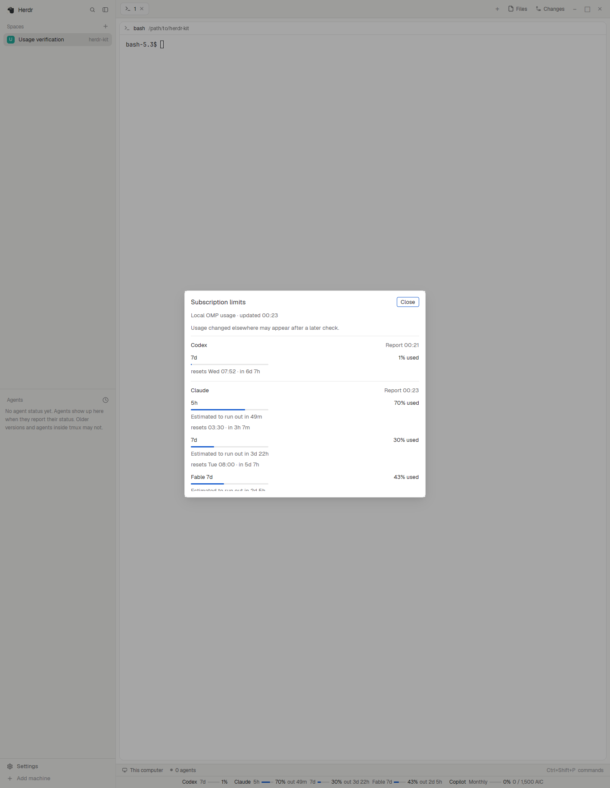

# herdr-kit

A local Rust workspace with native JavaScript mods and a personal layout for
[Herdr](https://herdr.dev). The approved modular extraction separates coordinator,
usage and optional installation/update ownership without a mandatory kit-core.
`kit-coord` and `kit-usage` each own their CLI and native mod; optional
`kit-manager` produces the `herdr-kit` installer. The layout composes them.
This is not a Herdr fork or browser frontend.



## Build and install

Requirements: Linux or macOS, Rust/Cargo, Git, tar, `hc`, `herdr-app`, and OMP
for usage reports. The JavaScript runs inside Herdr's GPUI host, not Node.
Node is only needed for the pure model tests.

```sh
cargo test --locked
node --test tests/*.test.js
cargo build --locked --release
# Installation uses committed source, including Cargo.lock.
./target/release/herdr-kit install --source "$PWD" \
  --app-home "$HOME/.config/herdr-app"
herdr-app do layout.switch --name herdr-kit
```

On macOS, pass your actual Herdr app home. `HERDR_APP_HOME` selects the window
for `herdr-app`; the installer takes its target explicitly. Installation does
not switch layouts, restart Herdr/Core, change shortcuts, or touch terminals.
The first install requires an existing app home and refuses naming collisions.

The stable installed command is `<data-dir>/bin/herdr-kit`. Default data is
`$XDG_DATA_HOME/herdr-kit` (normally `~/.local/share/herdr-kit`) on Linux and
`~/Library/Application Support/herdr-kit` on macOS. `--data-dir` or
`HERDR_KIT_DATA_DIR` provides explicit isolation. No shell configuration or
system-wide PATH is changed.

## Initial update source

The installed tool trusts the exact local Git repository supplied to `install`.
A revision is built from **committed HEAD**, via `git archive`, not from dirty
working files. Nothing is fetched, pulled, reset, stashed, or pushed.

```sh
<data-dir>/bin/herdr-kit status --json
<data-dir>/bin/herdr-kit source
<data-dir>/bin/herdr-kit update check
<data-dir>/bin/herdr-kit update apply
<data-dir>/bin/herdr-kit update rollback
```

`source --repo /absolute/repository` explicitly changes that trust decision.
The source must remain available, with its committed lockfile and build tools.
Cargo can access its configured dependency registry when a build needs it.
This is a trusted **local source-build channel**, not an unsigned remote binary
updater. Internet release downloads and release signing are not implemented.

When selected, the layout bar requests optional manager maintenance at startup
and every six hours. Rust schedules daily checks with one-hour failure backoff
under a cross-process manager lock. Capability-only installs never request
updates. Neither coordinator nor usage requires an installed manager.

Each immutable release contains the executable and matching native assets.
Mods have revision-specific names, and their generated runtime calls the exact
matching executable. A single atomic layout replacement activates a staged
mod generation; native file discovery settles asynchronously. Activation has
an on-disk recovery journal. Old generations remain available for rollback and
for personal layouts still referencing them. No automatic release deletion.

After activation, the coordinator hook reports `skipped` with reason
`forbidden_caller` when the invoking caller is not authorized to start it.
This does not assert that the coordinator is running; inspect `kit-coord status`
for its current state. Other hook failures remain failures.

The tool records content hashes. Modified managed layouts, mods, executables
or releases block replacement rather than discarding edits. User clones,
shipped Herdr files, `keys.json`, settings, programs, shared/view state and
layout click state are not owned by the updater. One app home is registered
per data directory; use an explicit separate data directory for an independent
installation.

### Selected component installation

`kit-packages.json` declares artifact ownership and the default `herdr-kit`
bundle. Omit `--component` to install the existing complete suite. An exact
component selection installs only its declared binary/mod assets and never
claims another layout:

```sh
cargo build --locked --release -p kit-manager
./target/release/herdr-kit --data-dir /absolute/private-root install \
  --source "$PWD" --app-home /absolute/consumer-app-home \
  --component kit-coord --revision <full-commit>
```

The JSON response returns `components` and `resolved_mods`; the external layout
owner chooses when to reference that exact generation. `kit-coord`, `kit-usage`,
`kit-coord-ui`, `kit-manager` and layout assets (`herdr-kit`) are separately
selected. `kit-coord-ui` requires only kit-coord, never kit-usage; selecting it
includes its coordinator dependency at the same pinned revision. Neither
capability installs the updater or another layout.

`update apply --component NAME` changes only selected components; omit it to
update the owned set. UI/coordinator dependency pins advance together.
Ordinary rollback restores the previous current-format selection, not a legacy
installation. Runtime bindings and layout projection are structural; protocol
keys are never globally renamed. Drift and unowned collisions refuse replacement.

The initial modular deployment is a **clean replacement**, not a migration.
The person stops the old coordinator/watcher and reopens fresh ones; see the
[exact package/install guide](docs/coordinator/monorepo-p2.md). Legacy receipt
envelopes, old-writer round trips, old namespaces and migration gates are removed.

## Usage statusbar

The named layout preserves the existing 28px Herdr statusbar. Machine, branch
and agent indicators stay on the left. On the right, the compact Limits
readout sits beside the coordinator status. Click Limits to view all providers,
windows, credits and estimates in the native details dialog. Escape/Close
dismisses it. Narrow bars omit the provider name instead of shrinking the text;
the command-palette shortcut still works.

Rust runs `omp usage --json --redact --no-extensions`, then keeps only anonymous
allowlisted quotas for Codex, Claude and Copilot. OMP owns authentication and
may refresh its existing credentials; herdr-kit does not read credentials or
make separate provider quota calls. Override source discovery with
`KIT_USAGE_OMP_EXECUTABLE` or `kit-usage snapshot --omp-executable PATH`.

```sh
<data-dir>/bin/kit-usage snapshot --json --agents-working
```

Source checks are spaced five minutes while idle, one minute after success
while agents work, and back off after failures. A private cache/lease and lock
prevent duplicate collectors across mod copies. UI reads normally run once a
minute. Unknown, zero, unlimited, unavailable and stale remain distinct.
Copilot AIC values are not rescaled. Details retain all accounts, reset times
and conditional pace estimates. Quotas are local to this machine, even when
viewing a remote Space. No Cockpit process, state, cache or installed files are
used.

## Coordinator

The coordinator helps a person organize agent work in workstreams and tasks.
It keeps the coordinator and its watcher visible in Herdr terminals, with a
status icon that can start the watcher when it is not running.

Use [the standalone package and clean-install guide](docs/coordinator/monorepo-p2.md)
to include only kit-coord in another layout, without usage, this layout or an
installed updater. It keeps the existing parent data root and `coord/` paths.
Explicit overrides are `KIT_COORD_DATA_DIR`, `KIT_COORD_HC` and
`KIT_COORD_HERDR_APP`; old capability environment names are not aliases.

```sh
<data-dir>/bin/kit-coord up
<data-dir>/bin/kit-coord status --json
<data-dir>/bin/kit-coord down
```

To try an uninstalled checkout without using an older installed executable,
build once and use a separate data directory:

```sh
cargo build --locked --release -p kit-coord
./target/release/kit-coord --data-dir "$HOME/.local/share/herdr-kit-preview" up
```

Keep that executable in place while the preview runs; rebuilding a running
development binary can invalidate its saved launch path. The app icon, board
and timeline ship as the separate `kit-coord` mod with normal suite
installation. Installation still reads committed source as described above.

The person can open and close workstreams, start, send to and close tasks,
release resources, record decisions and instructions, and rate outcomes.
The coordinator can do the same work-management operations, but only the person
can change configuration or ratings and start or stop the coordinator. Delegates
report and add notes to their own tasks. Anyone can read the board, log,
explanations, inbox, roles and statistics. `kit-coord --help` lists commands.

In the Coordinator dialog, choose **Clear context** (or press `n` while the
dialog list has focus) to request a fresh session when the coordinator is idle.
While waiting, **Restart now** (or `n` again) offers a confirmation before
interrupting a turn; press Enter to confirm or Esc to cancel.
The prior session remains in the session history.

The mod also receives a `restart` command through Herdr's key bindings. Because
installed mod names include the release revision, use the current coordinator
folder name in `keys.json`, for example:
`"global": { "ctrl-alt-n": "kit-coord-<revision>.restart" }`.
Update that binding when the installed revision changes.

### Mission Log

The separate `kit-coord-ui` mod adds **Mission log** to the sidebar. It opens
the Rail conversation view without replacing Board/Timeline or the raw
coordinator terminal. Its menu reuses the coordinator's Clear context,
Restart and Show actions. No key bindings are installed.
The package manager stamps its coordinator command binding in runtime metadata,
not by rewriting JS literals. In another layout, mount the kit-coord status view
as well as the Mission log launcher so the coordinator's existing registered
handlers are shown. Updating either member of that pinned UI/dependency pair
requires selecting both together; a mismatched generation is refused.

The rail interleaves real coordinator replies with placed tasks, delegate
reports, progress, decisions and questions. Question pills only fill the
composer; Enter or Send delivers the draft. Working state and elapsed time
come from the coordinator's actual hc turn, and the step is its latest tool
operation—not a simulated sequence. Send stays disabled during a turn.
The narrow working placeholder is deliberately short. Reduce motion in the
menu disables the orbit, shimmer and question pulse; the OS animation
preference is read once when the view opens when no override is set. The
motion override is kept across revision-named suite updates.

```sh
kit-coord conversation --json
kit-coord say --text 'A message for the coordinator'
```

`say` is person-only and always targets the recorded coordinator, never a
delegate. It sends the text unchanged through supported `hc send`, under the
same terminal lock as watcher delivery. `--question QID` records an answer
only after confirmed delivery. Use `kit-coord task send` for delegates.

`conversation` projects the exact current coordinator OMP session's active
branch. It excludes thinking, tool results, intermediate tool-use replies,
the startup brief and operational input. It reads the recorded session,
not terminal screen text, and reports missing, ambiguous or malformed
sources explicitly. After Clear context, prior-session replies remain in
OMP history rather than being copied into the new session's conversation.
The mod itself reads only coordinator CLI JSON. If kit-coord or the
coordinator is unavailable, it keeps the draft and shows a clear state.

State lives under `<data-dir>/coord/`, including the append-only journal,
configuration, roles and task files. Use `--role coord-design` on
`kit-coord task start` for UI/UX and visual design: it starts `omp --model @design`,
so OMP resolves the person's configured design model without naming a model
for every task. `coord-deep` uses `@slow` for open technical problems, not the
design model role.

`kit-coord roles` lists effective roles and model selectors; `kit-coord roles
coord-design` shows its commands without launching anything. Built-in roles
can be overridden with files in `coord/roles/`, or new named roles can select
any OMP `@role` or explicit model. See [roles and models](docs/coordinator-spec.md#roles-and-models)
for a complete role-file example, resume rules and statistics limitations.
Autostart is controlled by coordinator configuration. The watcher is a
`kit-coord watch` subcommand running in an hc terminal, not a hidden service.

The coordinator never closes spaces created by the person, never types into
startup dialogs, and does not reopen a coordinator tab the person closed.
The journal includes insight records such as operation and cause identifiers,
ratings and outcomes; `kit-coord stats --json` summarizes them. See
[the coordinator specification](docs/coordinator-spec.md) for the full model
and safety rules.

## Structure and extension boundary

- `Cargo.toml`: workspace, shared dependency versions and lockfile; no kit-core.
- `kit-packages.json`: explicit packages, binary/mod/layout ownership and bundle.
- `crates/kit-manager/src/main.rs`: optional installation/update CLI only.
- `crates/kit-coord/`: independent coordinator CLI, engine, roles and fixtures.
- `mods/kit-coord/`: independent native status, Board and Timeline.
- `crates/kit-usage/`: independent usage CLI, bounded OMP adapter and cache.
- `crates/kit-manager/src/manager/`: selected builds/receipts/activation/recovery.
- `mods/kit-usage/`: native GPUI presentation and pure view model.
- `mods/herdr-kit-bar/`: host chrome, readout composition and optional maintenance.
- `layouts/herdr-kit.json`: managed personal layout, built-in mods reused.

Independent capabilities belong in their own vertical packages, not behind an
accidental usage or updater dependency. Shared third-party versions and the
small compatible data-path policy do not justify a core service. Future
secure-store adapters must keep credentials in Rust and the OS keychain, use
them internally or through a child tool's supported input, and never return
them to JS/JSON or put them in argv/logs. This is an exposure policy, not a
same-user process sandbox. No secret-store commands ship today.

## Verification and provenance

Unit checks are the two commands above; native acceptance additionally needs
`herdr-app check` and a real window/screenshot in an isolated app home/core.
Never test update/recovery experiments against a personal running installation.
Initial Linux delivery passed 12 Rust behavior tests and 6 JS model tests, plus
native `herdr-app check` and real OMP usage in an isolated Herdr App 0.1.15 /
Core 0.1.20 window. The source-update smoke built a committed 0.1.1 executable
from an installed 0.1.0 source, verified rollback to 0.1.0, automatic maintenance
back to the new revision, and preservation of modified managed files and
unrelated configuration. Native macOS verification remains unperformed.

The usage parser/scheduling and view calculations adapt MIT-licensed Cockpit
by Konni Hartmann. Repository packaging follows Herdr's documented layout/mod
convention, illustrated by [herdr-max](https://github.com/maxjkfc/herdr-max);
its installer, keybindings and unrelated automation are not copied.
