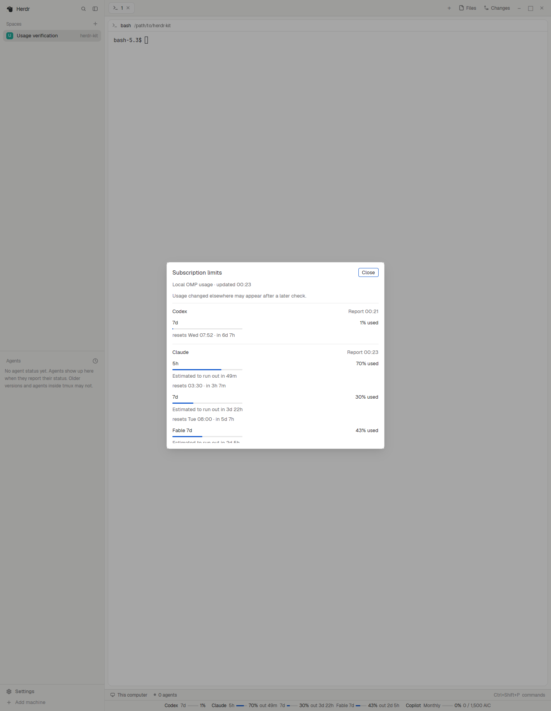

# Herdr Kit

A native Herdr workbench with a compact bottom-right subscription readout and
agent coordinator, backed by one extensible Rust command-line tool.

## What you see

Keep the stock Herdr Spaces/Agents sidebar, tab bar, terminal panes, Files and
Changes panels. In the existing 28px statusbar, preserve machine, branch and
agent indicators on the left. Place the compact Limits readout beside the
coordinator status on the right, with no extra row. Use the current theme and
normal Herdr UI font. Narrow bars omit the provider name. Click for a native
subscription-details dialog with all anonymous accounts,
source timestamps, windows, meters, AIC, resets and conditional exhaustion
estimates. Unknown/unlimited/zero/unavailable/stale remain distinct.

## How it behaves

The strip normally reads once per minute and reacts to working-agent demand.
Rust coordinates OMP collection (five-minute idle, one-minute successful-working
cadence, failure backoff) across copies. The details dialog uses the shared
anonymous snapshot instead of creating another collection loop. Escape or
Close dismisses it without terminal input. Changing Spaces does not retarget
local usage to a remote machine.

A separate gentle maintenance invocation checks the configured trusted local
Git source and builds only committed revisions. Rust schedules it once a day.
It updates the single tool, managed mods and default layout as a versioned
suite. User clones and personal settings/shortcuts remain untouched.

The coordinator keeps workstreams, tasks, decisions and reports in an
append-only local journal. The person controls it with `coord up`, `coord down`
and `coord status`; the status icon can start its visible watcher terminal.
People and the coordinator manage work, delegates report on their own tasks,
and the board, log, inbox, roles and statistics are readable by all callers.
Only the person changes configuration or rates outcomes. The data directory's
`coord/` holds state and role overrides; autostart is configurable.

The coordinator does not close spaces created by the person, type into startup
dialogs or reopen a coordinator tab the person closed. Operation, cause,
outcome and rating records support `coord stats --json`. See
`docs/coordinator-spec.md` for the full behavior and safety rules.

## Built from

- `layouts/herdr-kit.json`: custom layout retaining built-in mod references.
- `mods/herdr-kit-usage`: native GPUI View, pure JS model, deployment runtime.
- `mods/herdr-kit-coord`: native coordinator status, board and timeline.
- `src/coord/`: coordinator commands, journal, lifecycle and watcher.
- `src/usage*`: OMP adapter, private anonymous cache and scheduling.
- `src/manager.rs`: registered Git source, immutable release builds, hash
  receipts, activation journal and rollback.
- `herdr.exec`: explicit argv to the pinned release's single Rust executable.
- `herdr.openOverlay`, `props`, `theme`, `shared`, `nextCommand`: native UI.

## Watch out

No HTML, DOM, browser React, Node runtime or `Intl` in this mod. Never keep a
callback context for later use. Generation-specific mod names are stamped into
both the managed layout and runtime; overlays must use that generated name.
Never read credentials into JS or parse raw OMP output in the frontend. Source
build updates require Git, tar, Cargo and a committed Cargo.lock. This channel
trusts the local source repository; it is not a remote release downloader.

## Done when

Rust and pure JS behavior checks pass; `herdr-app check` passes; an isolated
native window shows real usage and details with no errors. A new committed
local-source revision updates executable and managed assets together, rollback
restores the prior generation, and edited/unowned files are preserved. The
selected live instance then shows the verified named layout without restarting
Core or ending existing terminals.
