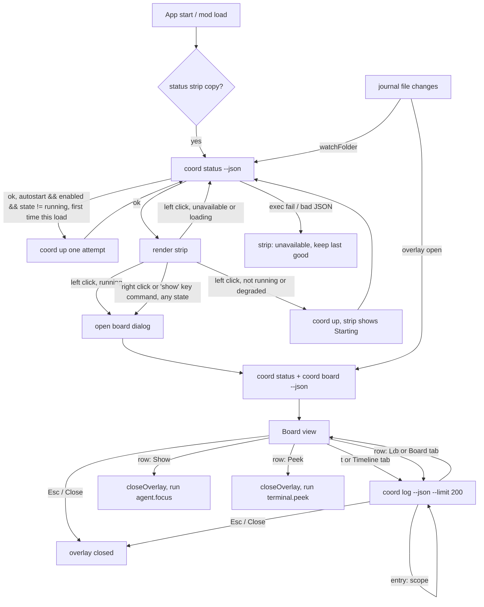

# Coordinator board: UI design

Status: implemented design, with the Board redesign below replacing the original card/column proposal. Authoritative inputs: `docs/coordinator-spec.md` (sections 6 "Autostart and the status icon", 9 "What the person sees", 12 "Details fixed for the first version"). The UI is a **separate mod `mods/herdr-kit-coord/`**, sharing no files with `mods/herdr-kit-usage/`.

Nothing here was run against the live window. Mockups use illustrative hex colours; the real mod reads `theme()`.

Contents: 1 Goal & users · 2 Evidence · 3 Flow · 4 Screens/components (4.1 status strip, 4.2 board, 4.3 timeline, 4.4 data contract, 4.5 refresh & process rules, 4.6 component breakdown) · 5 Interaction & keyboard · 6 Accessibility · 7 Options considered · 8 Open questions · 9 Acceptance scenarios · 10 Examples.

---

## 1. Goal & users

**User:** the one person running parallel agent work in Herdr. They talk to the coordinator agent; they do not manage tasks by hand. They need to know, at a glance and without leaving what they are doing:

1. Is the coordinator alive? (and start it if not)
2. Does anything need me? (questions, blocked or never-started tasks, stalled tasks)
3. What is in flight, and why was each task placed where it is?
4. Why is a workstream still around (retained)?
5. What happened, in order? (timeline, journal-backed)

**The UI is a read-only window onto the journal**, except for starting the coordinator (`coord up`) and the person's explicit clear-context action (`coord restart`). A pending request offers confirmed `coord restart --force`, which can interrupt a turn. Other effects are Herdr app commands that move the person's view, run only on an explicit click or key.

**Non-goals:** answering questions (the person answers in the coordinator's terminal), closing/releasing anything, editing roles or settings, backend design, layout-file or `manager.rs` edits (called out in 8 as dependent work).

---

## 2. Evidence (existing patterns reused)

| Pattern | Where | Reused as |
|---|---|---|
| Status bar block, 28 px high, `bg(t.chrome)`, `border_t(1)` with `t.border`, `text_size(11.8)`, `text_color(t.muted)` | `mods/herdr-kit-usage/main.js:98-99`, `layouts/herdr-kit.json` (`status` block, `"size":{"px":28}`) | Same strip look for the coordinator block |
| Readout is a `Button.new(id)` 26 px high, `px(6)`, `rounded(3)`, 1 px border that turns `t.accent` when focused, `hover(s=>s.bg(t.hover)...)`, `.tooltip(text)`, `.accessibility_label(text)`, `.on_click` | `main.js:66-74` | Same control anatomy |
| "needs you" uses `t.blocked` (`main.js:96`); warning uses `t.working` (`:15`); muted/dim text uses `t.muted`/`t.dim` | `main.js:15,96` | Same colour roles (4.1.4) |
| Details dialog: `openOverlay({mod, props:{view:'details'}, kind:'dialog', width, height})`, module-level `dialog` guard so only one opens, `role('dialog')`, `Close` button, `ScrollHandle` + `overflow_y_scrollbar`, `on_key_down` on a tracked focus handle, `this.handle.focus()` on open | `main.js:24,41-42,131` | Board overlay is a dialog with the same skeleton |
| Same View class renders both strip and overlay, chosen from `props().view`; module-level `strips` counter so only the strip copy polls; `nextCommand()` loop for `show`/`focus` | `main.js:18-41` | Same dispatch and polling-ownership trick |
| Data via `exec(BINARY, [...args(), ...], {timeout})`, `--data-dir` from stamped `DATA_DIR`, decode with a strict `decode*` that copies only protocol fields and throws `malformed` | `main.js:9,43-53`, `model.js:15-33`, `runtime.js` | Same contract style for the three coord commands |
| `setShared(KEY, snapshot)` + `shared(KEY)` so every copy re-renders from one fetch | `main.js:7,11,50` | Used for the status snapshot only (4.5) |
| Pure `model.js` with no host imports, tested by `node --test tests/*.test.js` (`package.json`: `"test":"node --test tests/*.test.js"`) | `tests/usage.test.js` | `model.js` + `tests/coord.test.js` |
| Mod folder gets renamed per release (`herdr-kit-usage-<rev>`); `runtime.js` is stamped with `BINARY`, `DATA_DIR`, `RELEASE`, `MOD_NAME` | `src/manager.rs:19,327-346` | Coord mod follows the identical contract (8, Q1) |
| Icons are 24x24 `stroke="currentColor"` stroke-1.5 SVGs drawn with `svg('mods/<name>/x.svg').size(13)`, tinted by text colour | `branch.svg`, `monitor.svg`, `main.js:89` | Four new icons in `board-mockups/icons/` |

### Herdr/gpui APIs this design relies on (all confirmed in `~/.config/herdr-app/herdr.d.ts`, `gpui-kit.d.ts`, `AGENTS.md`)

- `herdr`: `exec(cmd,args,{cwd?,on?,timeout?})` (timeout default 30000, max 600000), `run(name,args)`, `openOverlay({mod,props,kind:'dialog'|'popup'|'window',width,height,modal,frame,key,keep})`, `closeOverlay(id)`, `props()`, `theme()` (names: `chrome, surface, popover, raised, hover, selected, border, input, foreground, muted, dim, accent, accent_foreground, working, blocked, done, idle, unknown`), `shared(key)`, `setShared(key,value)`, `watchFolder(dir)` (Promise of changed paths; Linux skips git-ignored dirs, rejects trees > 4096 dirs), `nextCommand()`, `notify({title,body,level,timeout,action})`, `agents()` (`AgentInfo.address/status/space/tab/app`).
- App commands via `run`: `agent.focus {terminal}` ("Show an agent (sub-agents too)"), `terminal.peek {terminal}` ("Peek at a running terminal over the tab"), `space.select {id}`, `tab.select {id}` (verified in `/tmp/coord-captures/herdr-app-commands.json`).
- `gpui-kit`: `View`, `div()`, `svg(path)` (`.size`, `.spin(ms)`), `Context`: `cx.focus_handle()`, `cx.spawn`, `cx.timer.every(ms,fn)`, `cx.sleep(ms)`, `cx.notify()`, `cx.stop_propagation()`, `cx.write_to_clipboard(text)`; element builders `.child/.children/.when/.id/.on_click/.on_hover/.on_key_down/.on_mouse_down("right", fn)/.on_size_change/.tooltip(string)/.accessibility_label/.role(...)/.aria_selected/.aria_active_descendant/.track_focus/.tab_index/.tab_stop/.overflow_y_scrollbar/.track_scroll/.hover/.frames(list,ms)/.opacity/.disabled/.selected/.truncate/.text_ellipsis/.text_ellipsis_middle/.text_ellipsis_start/.whitespace_nowrap/.cursor_pointer/.font_semibold/.italic/.line_through/.min_w/.max_w/.flex_shrink_0`, `Role` strings `dialog, tab, tab_list, list, list_item, tree_item, group, status, alert, button, search_input, log`.
- `gpui-base`: `h_flex`, `v_flex`, `Button` (`Button.new(id)`), `ScrollHandle` (`ScrollHandle.new()`, `.scroll_to_item(i)`), `Input.new(state)`, `InputState.new({placeholder,value})` with `.value()`, `.set_value()`, `.focus()`, `.on('change'|'submit'|'focus'|'blur', fn)`.
- **Not used (not confirmed or unnecessary):** `line_clamp` (no declaration found), `Popover`, `Select`, `Tabs`/`Tab` (`Tab` takes no keys), `HTML/DOM`, `setTimeout`, Node APIs.

Facts that constrain the design:
- A layout block holds exactly one mod, so the coordinator strip needs its own block (7, Option A; 8, Q1).
- `tooltip` takes a plain string only and shows after 0.5 s of rest; it is not an accessibility substitute.
- `Esc` closes the top dialog or popup in the host; the mod cannot rely on seeing it. Therefore Escape always closes the board; nothing inside the board depends on intercepting Escape.
- `setShared` re-renders every mod; call it only when the value changed.
- Timers keep running while a copy is hidden: poll gently (4.5).
- Mods may not use `setTimeout`/`setInterval`: `cx.timer`, `cx.sleep` instead.

---

## 3. Flow



Primary paths:
1. **Glance:** read the strip. Nothing to click.
2. **Something needs me:** strip shows `1 needs you` in `t.blocked`; click opens the board; "Needs you" section is first and its row offers `Reply in coordinator` (focuses the coordinator terminal).
3. **Coordinator down:** strip shows `Coordinator off` or `Degraded · watcher stalled`; click starts it; strip shows `Starting…` until `coord up` returns and a status read confirms.
4. **Why is this still here:** board "Retained" section shows the reason and the checks that failed.
5. **What happened:** `Log` on any row, or the Timeline tab.

---

## 4. Screens and components

### 4.1 Status strip

#### 4.1.1 Placement and size

The strip is its own layout block, to the right of the usage block, in the 28 px status row:

```json
{ "id": "status", "type": "row", "size": { "px": 28 }, "resizable": false,
  "children": [
    { "id": "status-usage", "type": "block",
      "content": { "mod": "herdr-kit-usage", "props": { "view": "statusbar" } } },
    { "id": "status-coord", "type": "block", "size": { "px": 80 }, "min": 0, "max": 80,
      "content": { "mod": "herdr-kit-coord", "props": { "view": "statusbar" } } }
  ] }
```

Result, left to right: the usage block (machine, branch, agent count, then its right-aligned `Limits` readout), then the coordinator block. The coordinator owns its status lifecycle and commands; keeping it mounted preserves status refresh and autostart. The usage readout's 500 px breakpoint measures its own block, so with the 80 px coordinator sibling it switches at about 580 px of total row width. At very small widths it hides the extra-provider count if necessary.

Both blocks draw the same chrome background and top border. The coordinator button is right-aligned within its 80 px block, with a compact icon and text, a focus border, tooltip and accessible label.

#### 4.1.2 States and exact text

State is the status JSON's `state` (`running | not_running | degraded`) plus client-side states `loading`, `starting`, `unavailable`.

| State | Icon (13 px svg) | Icon colour | Full-tier text | Click (left) |
|---|---|---|---|---|
| running, counts all 0 | `coord-running.svg` | `t.accent` | `No tasks` (`t.dim`) | open board |
| running | `coord-running.svg` | `t.accent` | segments below | open board |
| not_running (incl. `enabled:false`) | `coord-off.svg` (hollow centre, dashed spokes) | `t.dim` | `Coordinator off` (`t.dim`) | `coord up` |
| degraded | `coord-degraded.svg` (ring with `!`) | `t.working` | `Degraded` (`t.working`) + ` · <reason>` (`t.dim`) | `coord up` |
| starting (our `coord up` in flight) | `coord-starting.svg`, `.spin(900)` | `t.dim` | `Starting…` (`t.dim`) | ignored (`disabled(true)`) |
| loading (first read pending, no snapshot) | `coord-off.svg` | `t.dim` | `Coordinator …` | re-read |
| unavailable (read failed or malformed, no usable snapshot, or snapshot older than 120 s with failing reads) | `coord-off.svg` | `t.dim` | `Coordinator unavailable` | re-read |

State is never encoded by colour alone: shape of the icon (filled centre / hollow dashed / ring with `!` / spinning arc) and the words differ.

Right-click (`on_mouse_down("right")`) and the key command `show` open the board in **every** state; the board works without a watcher because it is derived from the journal.

**Segments (running and degraded).** Always in this order, a zero segment is omitted:

| Segment | Text | Colour | Source |
|---|---|---|---|
| running | `{n} running` | `t.muted` | `status.counts.running` |
| needs you | `{n} needs you` | `t.blocked` | `status.counts.needs_you` |
| retained | `{n} retained` | `t.muted` | `status.counts.retained` |

Joined with ` · ` (`t.dim`). Examples: `3 running · 1 needs you · 2 retained`, `1 needs you`, `2 running`.

Degraded shows `Degraded · <reason>` instead of segments, and appends ` · {n} needs you` in `t.blocked` if `needs_you > 0` (the person must never lose that signal because of a degraded watcher).

**Degraded reason texts** (first reason in `status.degraded[]`, `+1` appended per extra): `watcher_heartbeat_stale` → `watcher stalled`; `watcher_missing` → `watcher stopped`; `coordinator_terminal_missing` → `coordinator missing`; `hc_unreachable` → `hc unreachable`; unknown code → code with `_` replaced by space.

#### 4.1.3 Width tiers and truncation

The VM (`statusbarModel`) picks a tier by estimated text width against the Button's inner width. Inner width = block width (from `on_size_change`) - 20 (block padding) - 12 (button padding) - 2 (border) - 19 (icon 13 + gap 6). Estimated text width = `ceil(chars * 6.2)` at 11.8 px `[INFERENCE: average glyph width of the UI font; verify with herdr-app shot and adjust the constant in one place]`.

| Tier | Chosen when | Shape |
|---|---|---|
| `full` | full text fits | icon + full-tier text from the table |
| `dots` | full does not fit but dots fit | icon + `● n` pairs: running dot `t.working`, needs-you dot `t.blocked`, retained dot `t.dim`, each 6 px circle (`div().size(6).rounded(3)`, as the usage mod draws its agent dot) + number; zero pairs omitted. For not_running: `Off`; degraded: `Degraded` (no reason); starting: `…`; unavailable: `n/a` |
| `icon` | nothing else fits (< ~70 px) | icon alone; when `needs_you > 0` a 6 px `t.blocked` dot to its right |

Last-resort safety: the text container always has `min_w(0)`, `truncate()`; a count with three digits therefore degrades to ellipsis before overflowing the block. The tooltip and the accessibility label always carry the full sentence, independent of tier.

At the default 280 px block: inner width = 280 - 20 - 12 - 2 - 19 = 227 px, and the longest running text `99 running · 99 needs you · 99 retained` (38 chars, ~236 px) drops to `dots`; the common `3 running · 1 needs you · 2 retained` (35 chars, ~217 px) fits `full`.

#### 4.1.4 Colour roles (theme tokens only)

| Role | Token | Used for |
|---|---|---|
| strip surface | `t.chrome`, border `t.border` | block background, top rule |
| body text | `t.muted` | segments, separators `t.dim` |
| healthy | `t.accent` | running icon |
| off / unknown | `t.dim` | not running, loading, unavailable, starting |
| warning | `t.working` | degraded icon and word, running-task dots |
| attention | `t.blocked` | needs-you text and dots |
| hover / focus | `t.hover` bg; focus border `t.accent` | readout button |

Hues are theme-dependent; legibility never relies on hue alone (shape + text, above).

#### 4.1.5 Tooltip and accessibility label

Same sentence for `.tooltip()` and `.accessibility_label()` (the usage mod does the same). `tooltip` takes a string only, so build it fully in the VM.

| State | Text |
|---|---|
| running | `Coordinator running. 3 tasks running, 1 needs you, 2 workstreams retained. Click to open the board.` Omit zero clauses; all zero: `Coordinator running. No tasks. Click to open the board.` |
| not running, enabled | `Coordinator is not running. Click to start it. Right-click opens the board.` |
| not running, never enabled | `Coordinator is off. Click to start it: this creates a "coordinator" space and starts the coordinator agent. Right-click opens the board.` |
| degraded | `Coordinator degraded: watcher heartbeat stale for 3m 20s. Click to repair (coord up). Right-click opens the board.` Reason sentence from `status.degraded[].detail` when present, else the reason text above. |
| starting | `Starting the coordinator…` |
| loading | `Reading coordinator status…` |
| unavailable | `Coordinator status unavailable: <first line of stderr, max 120 chars>. Click to retry.` |
| any, snapshot stale | append ` Last updated 14:02.` (HH:MM, 24 h, local time, as the usage mod prints times) |

Stale means the last good snapshot's `generated_at_ms` is older than 90 s while reads fail; the strip then shows a trailing ` ~` after the text (the usage mod's convention for stale values).

#### 4.1.6 Start behaviour (`coord up` from the strip)

- Click in `not_running` or `degraded`: set `starting = true`, call `coord up` (timeout 60 s), then immediately re-read status. `starting` clears when `up` settles, success or failure.
- Failure (non-zero exit or timeout): `notify({title:'Coordinator did not start', body:<first stderr line, max 160 chars>, level:'error', timeout: 8000})`; strip returns to its read state; the person can click again. No automatic retry.
- Never started before (`enabled:false`): no confirmation dialog, the tooltip says what a start does `(8, Q3)`.
- **Autostart:** after the first successful status read in this module load, if `status.enabled && status.autostart && status.state !== 'running'` and `autostartTried` (module-level flag) is false: set it and run `coord up` once with `notify` level `warning` (not `error`) on failure. Never repeated in the same module load. `coord up` is idempotent, so a hot reload that resets the flag is harmless. If `autostart` is false (`coord down` was run) nothing starts.
- The mod never runs `coord up` when `state === 'running'`, from the strip or from autostart.

### 4.2 Board overlay (view 1)

#### 4.2.1 Container

`openOverlay({mod: MOD_NAME, props: {view:'board', tab:'board'}, kind:'dialog', width: 760, height: 600})`. Board root: `role('dialog')`, `accessibility_label('Coordinator')`, `bg(t.popover)`, `text_color(t.foreground)`, 13 px text, 18 px padding, 12 px gaps. One board at a time (module-level `dialog` guard).

Below 640 logical px the header becomes two rows. The scrollable board and action dock retain the same single-column structure at every width.

Dialog (not `window`) because it is modal, `Esc` closes it without mod code, and the usage dialog sets that precedent; see Option B in 7.

#### 4.2.2 Structure and hierarchy

The Board is a title-led list of **continuous workstream groups**, not a collection
of selected cards and loose child rows. Needs-you items precede workstreams;
retained workstreams follow them. Section labels are sentence case with a quiet
count. Workstream headers and their tasks share `t.raised`; selected rows use
`t.selected` plus a persistent-width 2 px accent gutter. A group has 6 px outer
corners, no heavy outline. There is 8 px separation between workstreams.

Each heading and row remains a **direct scroll child**, so `scroll_to_item`
indices still match the keyboard's flat `boardModel.rows`. Details are children
of their row, never extra scroll items. Do not introduce nested scrolling groups.

**Header:** Coordinator, Board/Timeline tabs, state, Show coordinator, Close.
Below 640 px the title/tabs/Close occupy the first row and status/actions the
second. Healthy Board diagnostics are available in the state chip's tooltip and
accessibility label, rather than a permanent line. The full watcher heartbeat,
release, coordinator status and update time remain available there. Timeline
keeps its existing health line and layout.

**One owner per action:** when an empty state or banner already provides Start,
Repair or Show coordinator, the header omits the same action. The empty off
state therefore contains exactly one Start coordinator button. While starting,
body copy says “Starting coordinator…” and start actions are hidden. Data is
never cleared just because the coordinator is off.

**Banners:** errors, stale reads and degraded state remain visible, with Retry,
Repair or Start coordinator as appropriate. An in-flight start does not expose
a second start action. Watcher problems still explain that tasks keep running
while nudges and reconcile are paused. No new execution commands are introduced.

**Needs you:** question or warning glyph, wrapping question text, then its
workstream context and origin; age is secondary. Full text, options, ids and
since-time are available in Details. Unknown attention kinds remain represented.
Selecting an item exposes its existing actions in the dock, not in an inline
button row. This trades one-click inline actions for a stable board.

**Workstream:** chevron and semibold 14 px title. A quiet second line contains
repository name, correctly pluralized non-closed task count, and Closing when
applicable. No raw id or repeated delivery target is shown in the summary.
Details exposes the workstream id, repository path, full delivery target and
summary. Clicking or Enter toggles tasks. Existing attention-first, newest-event
ordering and persistent expansion choices are unchanged.

**Task:** title first; state word, optional report summary and age below.
There is no fixed state column, role column, raw-id/rung line or strike-through.
Task rows align beneath the workstream title within the same surface. State
words retain the model vocabulary and theme roles:

| State | Word | Theme role |
|---|---|---|
| placed | starting | idle |
| placed/running with start_blocked | stuck | blocked |
| running with stalled | stalled | blocked |
| running | running | working |
| reported done | done | done |
| reported blocked/question | blocked/asking | blocked |
| dormant/closed | dormant/closed | dim |
| unknown | raw value | unknown |

Attention states sort first, followed by running, starting, done and dormant;
ties use task number. Closed tasks remain behind a selectable disclosure with
correct singular/plural text. Opening it shows readable muted titles, not
crossed-out work.

**Technical detail:** task id, brief/result paths with Copy, report summary,
model, harness, placed/started time, nudges and rejected rungs remain available;
the Board also includes role and the selected rung/placement explanation.
Details values wrap and cap at 600 characters, at most 24 entries per panel.
Titles and one-line summaries cap at 240 characters with tooltips. Task title
tooltips retain the complete placement metadata. Rung labels are unchanged.

**Retained:** same grouped treatment; reason, automatic-clear explanation and
last-check age remain, with checks in Details and existing Show space/Log actions.
Retained workstreams are not duplicated among active workstreams.

#### 4.2.3 Stable selected-item action dock

The 68 px dock sits **outside** the scroll area above the short footer. Its
height never changes when selection changes. It names the selected item, then
shows actions in a fixed row, with a quiet accent outline on the first action.
No actions appear on hover, and selection never adds height to a task/header.

| Selected item | Dock actions |
|---|---|
| question | Reply in coordinator (if available), Log, Details |
| task / task attention | existing Show, Peek or Show space as applicable; Log, Details |
| workstream | Expand/Collapse, Show space (if known), Log, Details |
| closed disclosure | Show/Hide closed tasks |
| retained | Show space (if known), Log, Details |

Enter matches the first action (including workstream/disclosure toggling).
Details toggles the same expansion set as Right/Space. Non-navigation actions
return focus to the list; Show/Peek/Show space/Reply still close the dialog and
only navigate. Keyboard shortcuts `p`, `l`, `s`, `c`, `t`, `b`, `r` are unchanged.
Dock buttons have action-and-target accessibility labels. Tab visits dock
buttons after the list, then Close (Board index 11; Timeline retains index 7).
The footer is simply `↑↓ select   Enter open   → details   Esc close`.

#### 4.2.4 Loading, empty, off and errors

- Loading: native animated Reading board, Esc close; no dock.
- Running empty: “No work in flight.”, an explanation, and one Show coordinator
  button in the body when a coordinator terminal is known.
- Off empty: “The coordinator is off.”, explanation that Start creates a
  coordinator space/agent, and one Start coordinator button in the body.
- Off with cached work: keep the board and dock; one Start in its banner.
- Uncached failure: “Can't read the board.”, first error line, Retry.
- Cached failure: retain board, selection and dock under the stale-data banner.

Empty-state text uses an 18 px title and a centred, constrained 360 px explanation.
Only explicit detail/disclosure expansion changes row height.

#### 4.2.5 Decision and evidence

Two static directions were compared before implementation: continuous groups
with a selected-item dock, and a master/detail split. Groups were chosen because
the same hierarchy works at wide and narrow widths with one existing keyboard
list. Master/detail would add a second scroll/focus owner and a narrow drill-down
mode (whose Back would conflict with host Escape-close), and would reserve a
large empty detail pane on small boards.

The earlier polish altered metadata and action visibility without changing the
hierarchy. This redesign changes that structure instead. Theme tokens are used
throughout, with no new backend fields or commands. Requested design mocks and
isolated native screenshot evidence are stored under ignored
`evidence/board-overhaul/`; they are not release assets.

### 4.3 Timeline (view 2)

Same dialog, same header and health line; `Timeline` tab selected. Body:

```
 [Scope: ws-k3m2ab-t1 ✕]  [ filter text …                  /]  [Key events · 12 hidden]
 ──────────────────────────────────────────────────────────────────────────
 TODAY
 14:02:11  ?  coordinator  ws-k3m2ab-t1  Asked: Should the fix also bump the lockfile…
 13:58:40  ↗  coordinator  ws-k3m2ab-t1  Decision (digest): keep t1 on coord-default — cause is known
 …
 YESTERDAY
 17:12:03  ⚠  watcher      ws-7hn2cd     Retained: worktree has uncommitted files (3)
                              [ Load older entries (200) ]
```

**Order and grouping:** entries newest first by `seq` (descending; `ts_ms` only for display). Day separator rows (`TODAY`, `YESTERDAY`, then `Mon Nov 9`) are not selectable. Local time, 24 h, `HH:MM:SS`.

**Row (single line, 24 px, selectable):** `time (64, t.dim, tabular)` · `glyph (14, tone colour)` · `actor (84, t.muted, 11)` · `scope (100, t.dim, 11, shows task id, else workstream id, else empty)` · `summary (flex_1, min_w(0), truncate, t.foreground; tone colour for warning/attention kinds)`. In narrow width the actor column is dropped. Clicking the scope text sets the scope to that task or workstream.

**Scope and filtering**
- **Scope** (server-side): none, a workstream id, or a task id. Set by `Log` on any board row, `s` on a timeline entry, or clicking a scope id. Shown as a removable chip `Scope: ws-k3m2ab-t1 ✕`; `x`/Backspace on the list or the chip's ✕ clears. Maps to `coord log --ws <id>` or `--task <id>`. A workstream scope includes its tasks' entries (backend behaviour of `--ws`).
- **Filter text** (client-side, over loaded entries): `Input` bound to an `InputState` (`placeholder 'Filter id, kind, text'`); case-insensitive substring over `scope ids`, `kind`, `actor` and the one-line summary. `/` focuses it; Enter (`'submit'`) returns focus to the list.
- **Detail level** toggle (client-side), default `Key events`: hides noisy kinds `inbox.drained`, `res.intent`, `watcher.started`, `watcher.stopped`, `nudge.sent`, and `res.release_checked` with `ok:true`; the button shows `Key events · {n} hidden`; `a` or click toggles to `Everything`. The hidden count is for loaded entries.
- Empty-after-filter: `No entries match “{text}”.` + `Clear filter`.

**One-line summaries** (VM `summarize(entry)`): `glyph` and `tone` (`attention` = `t.blocked`, `warning` = `t.working`, `ok` = `t.done`, `neutral` = `t.foreground`, `quiet` = `t.dim`). Quoted values are clipped to 90 chars. Fields read from `entry.data` (4.4.3). Missing fields drop their clause.

| Kind | Glyph | Tone | Summary text |
|---|---|---|---|
| `ws.opened` | `◻` | neutral | `Opened workstream “{title}” ({repo} → {delivery_target})` |
| `ws.closed` | `◼` | neutral | `Closed workstream` + ` — {summary}` |
| `ws.cleaned` | `✓` | ok | `Cleaned up workstream` |
| `ws.retained` | `⚠` | warning | `Retained: {reason}` |
| `task.placed` | `▣` | neutral | `Placed · {role} · rung {rung} {rung label} — {reason}` |
| `task.started` | `●` | neutral | `Started in tab “{tab_name}” ({terminal})` |
| `task.reported` | `✓` done / `!` blocked / `?` question | ok / attention / attention | `Reported {done|blocked|question}: {summary}` |
| `task.progress` | `●` | neutral | `Progress: {summary}` |
| `task.closed` | `✓` | quiet | `Closed task` + ` — {reason}` |
| `task.dormant` | `◌` | quiet | `Agent ended; session recorded (dormant)` |
| `task.start_blocked` | `!` | attention | `Did not start within {after_secs}s — probably a start-up dialog` |
| `task.stalled` | `!` | attention | `Stalled: no report {silent_secs → age} after nudge` |
| `res.intent` | `·` | quiet | `Intent: create {type} {name}` |
| `res.created` | `+` | neutral | `Created {type} {name}` |
| `res.adopted` | `+` | neutral | `Adopted {type} {name} (yours; never removed)` |
| `res.release_checked` | `✓` ok / `✕` | quiet / warning | `Release check · {check} → {ok ? 'passed' : 'failed'}` + ` ({detail})` |
| `res.released` | `−` | neutral | `Released {type} {name}` |
| `nudge.sent` | `›` | quiet | `Nudged {target}` |
| `reconcile.finding` | `⚠` | warning | `Reconcile: {summary}` |
| `watcher.started` | `·` | quiet | `Watcher started (release {release[0:7]})` |
| `watcher.stopped` | `·` | quiet | `Watcher stopped` + ` — {reason}` |
| `coord.session_started` | `●` | neutral | `Coordinator session started ({role})` |
| `coord.session_ended` | `○` | neutral | `Coordinator session ended — {reason}` |
| `inbox.drained` | `·` | quiet | `Inbox drained ({count})` |
| `decision` | `↗` | neutral (`ask` tier: attention) | `Decision ({tier}): {what} — {why}` |
| `question.asked` | `?` | attention | `Asked: {text}` |
| `question.answered` | `✓` | ok | `Answered: {text}` |
| `scout.result` | `⌕` | neutral | `Scout: {summary}` |
| `instruction.set` | `✎` | neutral | `Standing instruction: {text}` |
| `thread.opened` / `thread.closed` | `◻` / `◼` | neutral | `Opened thread “{title}”` / `Closed thread “{title}”` |
| `correction` | `⟲` | warning | `You corrected: {what} — {why}` |
| *unknown kind* | `·` | quiet | `{kind}` + ` — {data.summary ?? data.text ?? data.title}` when a string exists |

**Details expansion:** Enter, Space or Right toggles an inline panel under the row (same style as board details): header line `seq {seq} · {full local date-time} · actor {actor} · v{v}`, then up to 12 `data` keys as `key  value` rows (strings clipped to 300, objects/arrays rendered as compact JSON clipped to 300, `brief`/`result`/path-like keys get a `Copy path` button), then `s scope to this task · c copy line`. One expanded entry at a time per list is **not** enforced; expansions are keyed by `seq` so they survive refresh.

**States**
- **Loading:** `Reading journal…` with the same `.frames` animation.
- **Empty (no scope):** `The journal is empty.` / `Nothing has happened yet.`
- **Empty (scoped):** `No entries for ws-k3m2ab-t1.` + `Clear scope`.
- **Error, no cache:** `Can't read the journal.` + first stderr line + `Retry`.
- **Error with cache:** stale banner as on the board; entries stay.
- **More older entries** (`has_more`): final row `Load older entries (200)`, selectable (Enter loads); loaded entries are capped at 2000, after which the row reads `Showing the newest 2000 entries. Narrow the scope to see older ones.`
- **New entries** arrive via the journal watcher; when the list is scrolled to the top they are prepended and the selection stays on the same `seq`; when the person has scrolled down, a one-line `{n} new entries ↑` pill (`t.accent` bg, `t.accent_foreground`) appears pinned at the top of the scroll area; click or `Home` jumps up and merges.

### 4.4 Data contract

The mod calls five commands. Every call is `exec(BINARY, [...dataDirArgs, 'coord', verb, ...], {timeout})` with `dataDirArgs = DATA_DIR ? ['--data-dir', DATA_DIR] : []` (same as the usage mod). `BINARY`, `DATA_DIR`, `MOD_NAME`, `RELEASE` come from a stamped `runtime.js`.

| Command | When | Timeout | Notes |
|---|---|---|---|
| `coord status --json` | strip: at load, every 20 s, and on journal change; overlay: on open and every 10 s while open | 10 s | cheap, no model calls |
| `coord up` | strip click in `not_running`/`degraded`, `Start`/`Repair` buttons, autostart once per load | 60 s | exit code only; stdout ignored |
| `coord restart [--force]` | explicit Clear context; force only after confirmation while pending | 60 s | requested waits for idle; force interrupts |
| `coord board --json` | overlay open, only while the Board view is shown | 15 s | |
| `coord log --json [...]` | overlay open, only while the Timeline view is shown | 15 s | |

Clear context stays in the dialog header, leaving the Board's selected-item dock
unchanged. `n` requests a graceful restart while the list has focus; the strip's
`restart` command opens the dialog and requests the same action. While pending,
the header offers Restart now (also `n`), followed by an inline interruption
warning with Restart now / Enter and Cancel / Esc. Closing the dialog dismisses
confirmation, not the request. Pending state comes from journal-backed `coordinator.restart_pending`,
so refresh/reload and CLI requests agree. Success requires a different, non-null
terminal and healthy running status; absence/degradation never means success.

Exit codes: `0` = JSON on stdout (always valid for the requested command, even when the coordinator is down). Anything else, a thrown `exec`, a timeout, or an unparsable/wrong-`schema_version` body is a *read failure* (the mod treats all four the same way). stdout is capped at 1 MiB by `exec`/`readTextFile` conventions; the decoder rejects larger text before parsing.

All timestamps are integer **milliseconds since the Unix epoch** (`*_ms`), like the usage snapshot; spec's journal `ts` is serialised this way in JSON output. Strings are UTF-8, may contain newlines; the mod never trusts length.

Decoders (`decodeStatus`, `decodeBoard`, `decodeLog`) follow `decodeSnapshot`: require `schema_version === 1`, validate types and caps, **copy only known fields**, tolerate unknown extra fields and unknown enum values (rendered raw/dim), throw `malformed` on structural errors.

#### 4.4.1 `coord status --json`

```ts
type Status = {
  schema_version: 1;
  generated_at_ms: number;
  release: string;                       // active release revision
  state: 'running' | 'not_running' | 'degraded';
  enabled: boolean;                      // a first `coord up` ever happened (config.json exists)
  autostart: boolean;                    // config.json: autostart
  degraded: Array<{                      // empty unless state==='degraded'
    code: 'watcher_heartbeat_stale' | 'watcher_missing' | 'coordinator_terminal_missing' | 'hc_unreachable' | string;
    since_ms: number | null;
    detail: string | null;               // one human sentence, e.g. "watcher heartbeat stale for 3m 20s"
  }>;
  watcher: {
    running: boolean;
    terminal: string | null;             // "t5"
    heartbeat_ms: number | null;         // last heartbeat
    release: string | null;              // release the watcher runs from
  };
  coordinator: {
    terminal: string | null;             // "t4" (hc address, bare for this computer)
    status: 'working' | 'idle' | 'blocked' | 'done' | null;   // hc status words
    space_id: string | null;             // "sp…"
    tab_id: string | null;
    session_started_ms: number | null;
    restart_pending: boolean;           // journal handoff not yet replaced by a new session
  };
  counts: {
    running: number;                     // tasks in state running (not stalled), plus placed-and-starting
    needs_you: number;                   // === board.attention.length
    retained: number;                    // workstreams with retained != null
    open_workstreams: number;
  };
  journal_dir: string;                   // absolute; what the mod passes to watchFolder
  journal_seq: number;                   // last seq (cheap change detector)
};
```
Semantics the mod relies on: `state` is computed by the CLI (`running` = fresh heartbeat and coordinator terminal present; `degraded` = either broken but something exists; `not_running` = neither). `counts.needs_you` equals the length of `board.attention` computed by the same fold, so strip and board never disagree.

Example:
```json
{"schema_version":1,"generated_at_ms":1763042861000,"release":"a1b2c3d4","state":"running","enabled":true,"autostart":true,"degraded":[],
 "watcher":{"running":true,"terminal":"t5","heartbeat_ms":1763042857000,"release":"a1b2c3d4"},
 "coordinator":{"terminal":"t4","status":"working","space_id":"sp3f9c…","tab_id":"tb81…","session_started_ms":1763030000000},
 "counts":{"running":3,"needs_you":1,"retained":2,"open_workstreams":3},
 "journal_dir":"/home/user/.local/share/herdr-kit/coord/journal","journal_seq":4821}
```

#### 4.4.2 `coord board --json`

```ts
type Board = {
  schema_version: 1;
  generated_at_ms: number;
  journal_seq: number;
  workstreams: Workstream[];             // open, closed-but-not-cleaned (incl. retained); cleaned ones omitted
  attention: Attention[];                // everything that needs the person
};
type Workstream = {
  id: string;                            // "ws-k3m2ab"
  title: string;
  state: 'open' | 'closed';              // 'cleaned' never appears here
  repo: { path: string; name: string } | null;
  delivery_target: string | null;        // branch, PR, or free text
  summary: string | null;                // current one-line summary (state.json)
  opened_ms: number;
  closed_ms: number | null;
  last_event_ms: number;
  space: { id: string; name: string; owned: boolean } | null;
  retained: null | {
    reason_code: string;                 // e.g. "uncommitted_files"
    reason: string;                      // one human sentence
    since_ms: number;
    checked_ms: number | null;           // last reconcile re-check
    auto_clears: boolean;                // reconcile re-checks it
    checks: Array<{ name: string; ok: boolean; detail: string | null }>;
  };
  tasks: Task[];
};
type Task = {
  id: string;                            // "ws-k3m2ab-t1"
  number: number;                        // the n of -t<n>
  title: string;                         // first line of the brief
  state: 'placed' | 'running' | 'reported' | 'closed' | 'dormant';
  report: 'done' | 'blocked' | 'question' | null;   // set when state==='reported'
  start_blocked: boolean;
  stalled: boolean;
  state_since_ms: number;                // when it entered its current state
  placed_ms: number;
  started_ms: number | null;
  last_event_ms: number;
  rung: 1 | 2 | 3 | 4 | 5;
  placement_reason: string;              // decision text for the chosen rung
  rejected_rungs: Array<{ rung: number; reason: string }>;
  role: string;                          // "coord-deep"
  harness: string | null;                // "omp"
  model: string | null;
  summary: string | null;                // latest report/progress summary
  terminal: string | null;               // "t7"; null when dormant/closed
  space_id: string | null;
  tab_id: string | null;
  brief_path: string | null;
  result_path: string | null;
  nudges: number;
};
type Attention = {
  id: string;                            // stable key for selection across refreshes
  kind: 'question' | 'task_question' | 'task_blocked' | 'start_blocked' | 'stalled' | 'coordinator_blocked';
  ws: string | null;
  task: string | null;
  since_ms: number;
  text: string;                          // question text, or the report summary, or a fixed sentence
  options: string[] | null;              // for `question`
  seq: number | null;                    // journal entry that raised it
};
```
Attention is *derived* (state fold): an unanswered `question.asked` (`question`), a reported-`question` task (`task_question`), reported-`blocked` (`task_blocked`), `task.start_blocked` still unresolved (`start_blocked`), `task.stalled` still unresolved (`stalled`), coordinator terminal `blocked` (`coordinator_blocked`). It clears when the journal resolves it (answered, new report, started, closed).

Example (abbreviated):
```json
{"schema_version":1,"generated_at_ms":1763042861000,"journal_seq":4821,
 "workstreams":[{"id":"ws-k3m2ab","title":"Fix login flow","state":"open","repo":{"path":"/path/to/herdr-kit","name":"herdr-kit"},
   "delivery_target":"main","summary":"t1 asking about lockfile","opened_ms":1763035000000,"closed_ms":null,"last_event_ms":1763042140000,
   "space":{"id":"sp91…","name":"herdr-kit","owned":false},"retained":null,
   "tasks":[{"id":"ws-k3m2ab-t1","number":1,"title":"Reproduce the login failure","state":"reported","report":"question","start_blocked":false,"stalled":false,
     "state_since_ms":1763042140000,"placed_ms":1763037619000,"started_ms":1763037622000,"last_event_ms":1763042140000,"rung":2,
     "placement_reason":"follow-up of the repro tab, same files","rejected_rungs":[{"rung":1,"reason":"session context exhausted"}],
     "role":"coord-default","harness":"omp","model":"gpt-6-luna","summary":"Should the fix also bump the lockfile?","terminal":"t7",
     "space_id":"sp91…","tab_id":"tb6f…","brief_path":"…/coord/briefs/ws-k3m2ab-t1.md","result_path":null,"nudges":0}]}],
 "attention":[{"id":"q-4790","kind":"question","ws":"ws-k3m2ab","task":"ws-k3m2ab-t1","since_ms":1763042140000,
   "text":"Should the fix also bump the lockfile, or leave it alone?","options":["Bump it","Leave it"],"seq":4790}]}
```

#### 4.4.3 `coord log --json`

Arguments the mod passes: `--json`, `--limit <n>` (default 200), and optionally `--ws <id>`, `--task <id>`, `--before-seq <s>` (entries with `seq < s`), `--after-seq <s>` (entries with `seq > s`). The spec lists `--since`, `--ws`, `--task`; `--limit`, `--before-seq`, `--after-seq` and `--json` are additions the mod requires (8, Q6).

```ts
type Log = {
  schema_version: 1;
  generated_at_ms: number;
  entries: LogEntry[];                   // ALWAYS newest first (seq descending), at most `limit`
  has_more: boolean;                     // older entries exist beyond the oldest returned
  newest_seq: number | null;
  oldest_seq: number | null;
};
type LogEntry = {
  v: number;                             // entry format version (spec: every entry carries one)
  seq: number;
  ts_ms: number;
  actor: 'coordinator' | 'watcher' | 'user' | 'cli' | string;   // `task:<id>` for delegates
  kind: string;                          // spec section 3 kinds; unknown kinds are shown generically
  ws: string | null;
  task: string | null;
  data: { [key: string]: unknown };      // kind-specific, fields listed below
};
```
Fields the mod reads from `data` (all optional; missing = clause dropped). These are the names requested of the journal writer:

| Kind | `data` fields read |
|---|---|
| `ws.opened` | `title`, `repo`, `delivery_target` |
| `ws.closed` | `summary` |
| `ws.retained` | `reason` |
| `task.placed` | `rung` (1-5), `role`, `model`, `reason`, `brief`, `rejected: [{rung, reason}]` |
| `task.started` | `terminal`, `tab`, `tab_name`, `session` |
| `task.reported` | `outcome` (`done`\|`blocked`\|`question`), `summary`, `result` |
| `task.progress` | `summary` |
| `task.closed` / `task.dormant` / `watcher.stopped` / `coord.session_ended` | `reason` |
| `task.start_blocked` | `after_secs` |
| `task.stalled` | `silent_secs` |
| `res.intent` / `res.created` / `res.adopted` / `res.released` | `type`, `name` |
| `res.release_checked` | `resource`, `check`, `ok`, `detail` |
| `nudge.sent` | `target` |
| `reconcile.finding` | `summary` |
| `watcher.started` | `release` |
| `coord.session_started` | `role`, `terminal` |
| `inbox.drained` | `count`, `cursor` |
| `decision` | `what`, `why`, `tier` (`silent`\|`digest`\|`ask`) |
| `question.asked` / `question.answered` | `text` |
| `scout.result` | `summary` |
| `instruction.set` | `text` |
| `thread.opened` / `thread.closed` | `title` |
| `correction` | `what`, `why` |

Example entry: `{"v":1,"seq":4790,"ts_ms":1763042140000,"actor":"coordinator","kind":"question.asked","ws":"ws-k3m2ab","task":"ws-k3m2ab-t1","data":{"text":"Should the fix also bump the lockfile, or leave it alone?","options":["Bump it","Leave it"]}}`.

Caps enforced by decoders: workstreams ≤ 200, tasks per workstream ≤ 500, attention ≤ 200, entries per page ≤ 500, any string ≤ 20 000 chars (clipped, not rejected), `data` keys ≤ 64.

### 4.5 Refresh strategy and process rules

**Who polls.** Exactly one *poller* per data kind, owned like the usage mod's `strips` counter:
- Status: the strip copy (module-level `strips` counter; copies other than the first do nothing). The board overlay also refreshes status on open and while open, through the same module-level in-flight guard.
- Board and log: the overlay copy, only while open and only the visible view.
- Status snapshot is shared across copies with `setShared('herdr-kit.coord.status.v1', snapshot)`, **only when the decoded snapshot differs** (compare `JSON.stringify` of the snapshot without `generated_at_ms`), so unchanged reads cause no cross-mod re-render. Board and log are kept in a module-level cache (they are consumed only by the overlay and can be large; they are not persisted to `shared.json`).
- A snapshot read from `shared()` older than 90 s counts as stale (it may come from a previous app run).

**Triggers**

| Trigger | Action |
|---|---|
| mod load (strip) | `status`; autostart rule (4.1.6) |
| journal change | `watchFolder(journal_dir)` resolves → status (strip, coalesced); if overlay open: board or log increment (coalesced) |
| slow timer | `cx.timer.every(20000)` strip → status; `cx.timer.every(10000)` overlay → status + visible view |
| age text | `cx.timer.every(60000, cx => cx.notify())` strip; `every(30000)` in the overlay (ages tick without exec) |
| overlay open | immediate status + board (or log) read; render from cache meanwhile |
| view switch | immediate read of the newly shown view if cache is older than 3 s |
| `r` / Retry / strip click while unavailable | immediate read, bypasses the min-interval below |
| `coord up` settles | immediate status; if overlay open also board |

**Journal watching.** `journal_dir` = `status.journal_dir`, else `DATA_DIR + '/coord/journal'`, else no watching (timers only). Loop per copy that needs it:

```js
cx.spawn(async cx => {
  while (!this.closed) {
    let paths;
    try { paths = await watchFolder(dir); }       // resolves with changed paths, bounded
    catch (_) { await cx.sleep(30000); continue; } // folder missing before first `up`, or watch rejected
    if (this.closed) break;
    this.onJournal(cx);                            // coalesce, see below
  }
});
```
Watch **only `coord/journal/`**, never `coord/` (sessions' `.jsonl` files change on every agent token and would flood events; the spec's `state.json` also churns). The heartbeat file must live outside `journal/` for the same reason (8, Q7). If the watch rejects (e.g. > 4096 dirs) the 20 s / 10 s timers carry the load; no error is shown.

**Coalescing.** `onJournal` sets `dirty = true`; if no refresh of that kind is in flight and ≥ 750 ms passed since the last one, run it; else schedule one run for the end of the window (`cx.sleep`). While a run is in flight, further events only set `dirty`; when the run ends and `dirty` is set it runs once more. This bounds execs to ~1.3/s per kind regardless of event rate. Incremental log reads use `--after-seq newest_seq` and merge by `seq` (de-dup).

**Failure handling.** On read failure: keep the last good snapshot, set `failed = true`, record `{at, firstLine}`. Three consecutive failures or a snapshot > 120 s old → the strip shows `unavailable`; the board keeps showing cached data under the stale banner. A later success clears the flag. No exponential logic is needed; the timers are already slow. A failing overlay read does not spam: one banner, no `notify`.

**What the mod must never do**
- Run nothing except `herdr-kit [--data-dir X] coord status|up|restart|board|log …`; `restart --force` requires an explicit confirmation while a request is pending. Never `coord down`, `task`, `ws`, `release`, `decide`, `ask`, `report`, `explain`, `inbox`; never `hc`, `herdr-app`, `git`, `sh`.
- Never send text to a terminal or answer a question; never `terminal.kill`, `space.close`, `tab.close`, or any command that closes or creates structure.
- Never write files (`writeTextFile`, `fs.writeFile`) or settings; the only persisted mod state is the status snapshot in `shared`.
- Never call `coord up` while `state === 'running'`, and never more than once per click or once per module load for autostart.
- Never move the person's view except from an explicit click/Enter on a row action (`agent.focus`, `space.select`, `tab.select`) or `Show coordinator`. `terminal.peek` is likewise only on explicit action. Opening the board or refreshing never changes focus; an exception is `this.handle.focus()` inside the mod's own overlay.
- Never poll `coord board`/`coord log` when the overlay is closed.
- Never use `setTimeout`/`setInterval`; never keep a `cx` across an `await` outside `cx.spawn`/`cx.timer` callbacks.

### 4.6 Component breakdown

Folder `mods/herdr-kit-coord/` (implementation target; not created here):

```
mod.json                {"place":"none","focusable":true,"overlay":{"width":760,"height":600}}
runtime.js              stamped by manager.rs: BINARY, DATA_DIR, RELEASE, MOD_NAME (same shape as usage)
main.js                 default-exported View: picks mode from props().view ('statusbar' | 'board'), owns focus handles, timers, key handling, wiring VM <-> store <-> ui
store.js                the ONLY module that calls exec/watchFolder/setShared/shared; in-flight guards, coalescing, caches, autostart flag, up()
model.js                pure view-model, NO imports from herdr/gpui (testable with node --test)
ui-common.js            small element builders: chip, dot, actionButton, sectionHeading, detailRows, bannerRow, emptyState
ui-status.js            renderStatusStrip(vm, t, handlers) -> element
ui-board.js             renderBoard(vm, t, handlers) -> element
ui-timeline.js          renderTimeline(vm, t, handlers) -> element
coord-running.svg, coord-off.svg, coord-degraded.svg, coord-starting.svg   from docs/coordinator/board-mockups/icons/
tests/coord.test.js     node --test, imports ../mods/herdr-kit-coord/model.js
```
(`ui-*.js` take already-computed VM objects and a theme object; they hold no business logic and are verified by `herdr-app check` and screenshots, not unit tests.)

**`model.js` exports** (all pure; `now` is passed in, never read from `Date`):

| Function | Purpose |
|---|---|
| `decodeStatus(text)`, `decodeBoard(text)`, `decodeLog(text)` | strict decoders, 4.4 |
| `statusbarModel(status, ctx)` → `{ state, tier, icon, iconRole, segments:[{key,text,compact,role}], text, compactText, tooltip, label, click, stale }` | 4.1; `ctx = { width, now, starting, failed, lastOkMs, now }`; includes tier selection `fit(width, segments)` |
| `estimateWidth(text)` | `ceil(chars*6.2)`; one constant |
| `reasonText(code)`, `degradedSentence(status)` | 4.1.2 |
| `boardModel(board, status, ui)` → `{ banner, header, health, sections:[{id,title,count,rows}], rows (flat navigable list), empty:{kind,...}|null }` | 4.2; `ui = { collapsed:Set, showClosed:Set, expanded:Set, liveAgents:Map<address,status>, now }` |
| `taskRow(task, ctx)`, `attentionRow(item, ctx)`, `workstreamRow(ws, ctx)`, `retainedRow(ws, ctx)` | row VMs: `{ key, kind, depth, selectable, title, meta, state:{word,role}, age, actions:[{id,label,primary,enabled}], details:[{label,value,copy?}], tooltip }` |
| `rowActions(row, status, liveAgents)` | action list per row kind (4.2.2) |
| `actionCommand(action, row, status)` → `{ kind:'run', name, args } \| { kind:'up' } \| { kind:'log', scope } \| { kind:'toggle' } \| { kind:'copy', text }` | maps an action to an effect description; `main.js` executes it |
| `moveSelection(rows, selectedKey, key, page)` → new `selectedKey` | keys `up,down,home,end,pageup,pagedown`; skips non-selectable; clamps, no wrap |
| `reconcileSelection(rows, prevKey, prevIndex)` | after refresh: same key, else nearest index |
| `timelineModel(log, ui)` → `{ rows, hiddenCount, scopeChip, empty, banner, newerPill }`; `ui = { scope:{ws?,task?}, text, detail:'key'|'all', expanded:Set<seq>, now }` | 4.3 |
| `summarize(entry)` → `{ glyph, tone, text, scopeId, actorLabel, details:[{label,value,copy?}] }` | the summaries table; unknown kind fallback |
| `mergeLog(prev, next, mode)` → merged entries | `mode: 'replace' \| 'prepend' \| 'append'`; de-dup by `seq`, newest-first, cap 2000 |
| `logArgs(scope, {limit, beforeSeq, afterSeq})` → argv array | builds the `coord log` args; keeps `store.js` trivial |
| `formatAge(ms)`, `formatClock(ms)`, `formatDay(ms, now)`, `clip(text,max)`, `oneLine(text)`, `rungLabel(n)` | text helpers |
| `nextRefreshDelay(state, now)` | coalescing decision: `{ runNow } \| { waitMs }` (pure so it is testable) |

`boardModel.rows` is the single flat array the keyboard walks; `ui-board.js` renders from `sections` but uses `rows[i].key` for selection, `aria_selected`, `aria_active_descendant` and `scroll_to_item`.

**`main.js` responsibilities** (kept thin): construct `ScrollHandle`, `FocusHandle`s and the filter `InputState` in `init`; start timers/watch loops; call `store` for data; build VM; call `ui-*`; execute `actionCommand` results (`run(...)`, `closeOverlay`, `store.up`, `cx.write_to_clipboard`); handle `nextCommand()` (`show` opens the board, `timeline` opens it on the Timeline, `focus` focuses the strip button).

**State ownership**
- Module-level (plain bookkeeping only; no host calls at import time): `strips`, `dialog`, `autostartTried`, in-flight flags, caches.
- Per copy: `selectedKey`, `expanded`, `collapsed`, `showClosed`, `view`, `scope`, `filter`, `detail`, handles.
- Persisted: only the status snapshot (`shared`).

**Required tests** (`tests/coord.test.js`; each listed behaviour is a case):
1. `decodeStatus/Board/Log`: accept the examples in 4.4; reject wrong `schema_version`, negative timestamps, oversize arrays, non-array `tasks`; copy only known fields (extra `email` dropped); unknown enum values survive.
2. `statusbarModel`: text for each state; zero segments omitted; `No tasks`; degraded keeps `needs you`; tier choice at widths 280, 150, 80, 60 for typical and three-digit counts; `starting` disables click; stale suffix `~`; tooltip sentences; click mapping (`board`/`up`/`reread`/`none`).
3. Autostart predicate `shouldAutostart(status, tried)` (add to model): false when `enabled` false, `autostart` false, state `running`, or already tried.
4. `attention` ordering oldest-first; `boardModel` section order, workstream ordering (attention first, then `last_event_ms`), task ordering within a workstream, closed-task disclosure, retained workstream not duplicated under Workstreams.
5. `taskRow`: state word and colour role for every state/flag combination; placement line format; clipping (240) and `oneLine`; unknown state raw + `unknown` role.
6. `rowActions`: Show/Peek only with a terminal; `dormant` falls back to `Show space`; question rows offer `Reply in coordinator` only when `coordinator.terminal` exists; `actionCommand` returns exactly `agent.focus`, `terminal.peek`, `space.select`, `tab.select`, `up`, `log` effects and nothing else.
7. `moveSelection`: skips headings, clamps at ends, page jumps, `reconcileSelection` keeps key or nearest index.
8. `summarize`: one assertion per kind in the table, missing-field clause dropping, unknown kind fallback.
9. `timelineModel`: day separators (`TODAY`, `YESTERDAY`, date), key-event hiding and `hiddenCount`, text filter, scope chip, `has_more` row, 2000 cap.
10. `mergeLog`: prepend de-dup, append, replace, order.
11. `logArgs`: exact argv for scope none/ws/task, before/after seq.
12. `nextRefreshDelay`: coalescing (in-flight sets dirty; 750 ms window).
13. `formatAge`: `<1m`, `12m`, `3h 5m`, `1d 4h`; `formatDay`.

---

## 5. Interaction and keyboard

### 5.1 Pointer

| Target | Action |
|---|---|
| Strip, left click | per state (4.1.2) |
| Strip, right click | open board (any state) |
| Strip hover | `t.hover` background; tooltip after 0.5 s |
| Row click | select row (and focus the list) |
| Row click on workstream / closed-disclosure | toggle expand |
| Selected-item dock actions | run the action; Show, Peek, Show space, Reply in coordinator close the dialog first |
| Scope chip ✕ / scope id | clear / set scope |
| Dialog backdrop click | closes (host default for dialog) |
| Scroll wheel | scrolls the list |

Action buttons stop propagation. Board hover changes only the background; actions live in the fixed dock. Non-navigation dock/banner actions restore list focus.

### 5.2 Keyboard (overlay)

Handler lives on the list container (`track_focus(listHandle)`, `tab_index(6)`, `on_key_down`), so keys typed in the filter `Input` never reach it. Keys are `event.key` values as the usage mod reads them (`down`, `up`, `pagedown`, `pageup`, `home`, `end`; plus `enter`, `space`, `left`, `right`, `escape`, `backspace`, letters; the exact strings for the non-arrow keys are `[INFERENCE]` from `KeyEvent.key` being "the key printed on the key", e.g. `"escape"`, and are verified in the first `herdr-app check`/smoke run); modified chords (`ctrl-…`) are ignored by the list so host shortcuts keep working.

| Key | Board | Timeline |
|---|---|---|
| `↑` `↓` | previous / next selectable row, scroll into view (`scroll_to_item`) | same |
| `Home` `End` | first / last row | same (`Home` also merges the `new entries` pill) |
| `PageUp` `PageDown` | -/+ 8 rows | same |
| `Enter` | primary action of the row (Show / Reply in coordinator / Show space / toggle workstream) | toggle details; on the `Load older` row, load |
| `→` or `Space` | open details | open details |
| `←` | close details; on a workstream row, collapse | close details |
| `p` | Peek (task rows) | - |
| `l` | open Timeline scoped to the row's task, else workstream | - |
| `s` | Show space (workstream row) | scope to the selected entry's task, else workstream |
| `x` or `Backspace` | - | clear scope |
| `a` | - | toggle `Key events` / `Everything` |
| `/` | - | focus filter input |
| `t` / `b` | switch to Timeline / Board | switch to Board (`b`), `t` no-op |
| `r` | refresh now | refresh now |
| `c` | copy the selected row's id | copy the selected entry as one line |
| `Tab` / `Shift+Tab` | Board tab 1, Timeline tab 2, Start/Repair 3, Show coordinator 4, list 6, dock 7–10, Close 11 | tabs/header unchanged, filter 5, list 6, Close 7 |
| `Esc` | closes the dialog (host) | closes the dialog (host) |

Conflicts: no global shortcut is bound by the mod. The person may bind `"<mod name>.show"` in `keys.json` (`show` = open board, `timeline` = open Timeline, `focus` = focus the strip); the mod name is generation-suffixed by `manager.rs`, so no default binding is shipped `(8, Q8)`. The list ignores modified keys, so `ctrl-shift-…` host chords keep working.

Initial focus: opening the overlay focuses the list container (`handle.focus()`), selecting the first selectable row (the first attention row if any). Re-focus the list after any view switch.

Selection survives refreshes by `key` (`attention.id`, `task.id`, `ws.id`, `entry.seq`); if its row disappears, the nearest index is selected.

### 5.3 Focus order and the strip

The strip's `Button` has `tab_index(0)`, accepts Enter/Space as click (keyboard activation counts as `on_click`), and shows the accent border when focused (usage mod pattern). The `focus` command focuses it.

---

## 6. Accessibility

- Strip: `.accessibility_label(fullSentence)` identical to the tooltip (4.1.5). Every state has distinct words, so nothing depends on colour or icon shape alone.
- Dialog: `role('dialog')`, `accessibility_label('Coordinator')`; tab buttons use the native `.selected()` state; the list has `role('list')`, workstreams `tree_item`, other rows `list_item`. Selected rows carry `aria_selected(true)` and `aria_active_descendant()`. Errors are alerts; Board diagnostics are on the status chip, Timeline keeps its status line. The dock is a labelled toolbar.
- Row accessibility label (VM `row.label`): `Task ws-k3m2ab-t1, running 34 minutes, Patch session refresh, role coord-deep, rung 4 new worktree, conflicting edits in auth/session.rs`. Expanded state announced via `aria` is not available; the details panel text follows the row in the tree.
- Focus: selected Board rows have an always-reserved 2 px accent gutter; Timeline retains its existing selection treatment. Actions are reachable via shortcuts and Tab through the dock/header.
- Contrast: text uses foreground/muted on raised/selected; dim is reserved for non-essential counts/hints. Status always has a word as well as colour.
- Hit targets: strip 26 px, actions 22 px, Board rows padded 10 px vertically (closed disclosure 6 px). Zoom scales all metrics.
- Motion: only native `frames`/`spin` (stop when not shown); no timers for animation. Reduced-motion preference is not exposed to mods `[INFERENCE]`; both animations are short-lived loading cues.
- Text sizes follow zoom (`settings().zoom`, sizes written at zoom 1).

---

## 7. Options considered

**A. Where the strip lives**

| | A1 separate layout block next to usage (**recommended**) | A2 extend `herdr-kit-usage` | A3 inside the usage mod's block via a second mod |
|---|---|---|---|
| Matches the user's decision (separate mod) | yes | no | impossible: one mod per block |
| Layout change | `status` block becomes a row of two blocks | none | n/a |
| Failure isolation | each mod can fail independently | a coordinator bug takes down the usage readout | n/a |
| `manager.rs` | must install, stamp and rename a second mod | none | n/a |

Tradeoff: A1 needs a layout edit and a `manager.rs` generalisation (both outside this task); chosen because the user decided on a separate mod.

**B. Board container**

| | B1 dialog (**recommended**) | B2 `window` (`key`, `keep`) | B3 pane/tab (`tab.new {mod}`) |
|---|---|---|---|
| `Esc` closes without mod code | yes | no, host sends Esc to the mod | closes the tab, not Esc |
| Matches usage details | yes | no | no |
| Keep open while working | no (dims the app) | yes, draggable, stays | yes, but takes terminal space |
| Needs to close before `Show` | yes (acceptable: Show navigates away anyway) | no | no |

Chosen B1 for v1: the board is glance-and-act; `Show` leaves anyway. B2 is the natural v2 for people who want a live wall display (Q2).

**C. Row action for "show me this agent"**

| | C1 `agent.focus` (**primary**) | C2 `terminal.peek` (secondary) |
|---|---|---|
| Effect | moves the person's view to the agent | opens it over the current tab, view stays |
| Spec | section 9 names `agent.focus` | not named |

Both offered: Enter = Show, `p` = Peek. Both only on explicit action.

**D. Filter UI in the timeline**

| | D1 scope chip + text box + key/all toggle (**recommended**) | D2 two dropdowns (`Select`) |
|---|---|---|
| Needs `Select`, whose arrow-key navigation is not built in | no | yes |
| Works from a board row's `Log` | yes | needs extra wiring |
| Server-side filter for big journals | yes (`--ws/--task`) | same |

**E. Timeline loading**

| | E1 pages of 200 + `Load older` + incremental `--after-seq` (**recommended**) | E2 virtual list over everything |
|---|---|---|
| Complexity | plain scroll area, `ScrollHandle` | `v_virtual_list` with per-item heights for expanded rows, renderer cannot hold handlers |
| Journal growth | bounded (cap 2000 loaded) | unbounded fetch |

---

## 8. Open questions

| # | Question | Options | Recommended default |
|---|---|---|---|
| Q1 | Layout and installer: the strip needs its own block and a second installed mod. `src/manager.rs` today stages only `herdr-kit-usage` (const `MOD`, line 19), rewrites that literal, requires `layouts/herdr-kit.json` to contain it and stamps one `runtime.js`. | (a) generalise to a list of mods and rewrite each name in the layout; (b) ship the coord mod unmanaged | (a): both mods generation-suffixed and `herdr-app check`ed like usage. The layout row shape is in 4.1.1. Outside this task. |
| Q2 | Board as `dialog` or `window`? | dialog / window | dialog (7, B). Revisit after use. |
| Q3 | First-ever start (`enabled:false`) confirm? Starting creates a space and runs an agent harness. | confirm popup / tooltip only | tooltip only (4.1.5); the click is deliberate and the coordinator is the product's core. |
| Q4 | Autostart when `degraded` too? | only `not_running` / also `degraded` | also `degraded`, once per load (spec: "mod runs `coord up` at app start"; `up` is idempotent and repairs). Not when `running`. |
| Q5 | `needs_you` exact definition. | attention list as defined in 4.4.2 / questions only | attention list (strip, board and spec "needing the person" agree). Backend must fold it once. |
| Q6 | `coord log --json` additions: `--limit`, `--before-seq`, `--after-seq`, JSON entry shape (`ts_ms`, `ws`, `task`, `data`, `v`). The spec lists only `--since --ws --task`. Also journal field names in 4.4.3. | add flags / mod filters everything client-side | add flags; client-side-only would force reading the whole journal on every refresh. |
| Q7 | Heartbeat file location. If it is written inside `coord/journal/` every beat triggers a refresh. | `coord/heartbeat.json` / inside journal | `coord/heartbeat.json`, outside `journal/`. |
| Q8 | Keybinding for `show`. | ship a default / leave unbound | leave unbound (mod folder name changes per release, `keys.json` entries would go stale). |
| Q9 | Closed-but-not-cleaned, not-retained workstreams. | show as `closing` / hide | show under Workstreams as `closing · age` so work never vanishes unexplained; hide when `cleaned`. |
| Q10 | Standing instructions, open threads, recent decisions on the board. | add a section / timeline only | timeline only for v1 (spec section 9 lists none of them for the board). |
| Q11 | Timestamps in JSON: spec says `ts`. | ms integers `ts_ms` / ISO strings | ms integers (usage snapshot precedent). |
| Q12 | Width estimate constant (6.2 px/char at 11.8 px). | measure / keep | keep as a single constant; verify with `herdr-app shot` and tune. |
| Q13 | The usage block's left side already prints `· N needs you` for *blocked agents* (`main.js:96`), and the coordinator strip prints `N needs you` for coordinator attention items. A blocked delegate is counted by both. | keep identical wording / rename the strip's segment (`N asking`, `N waiting on you`) | keep identical wording: both mean "this needs the person", they sit side by side, and the spec's own phrase is "needing the person". Add the strip's tooltip sentence (4.1.5) so the sources are distinguishable. |

---

## 9. Acceptance scenarios

Each is an observable check after the mod is built; checks marked (shot) use `herdr-app shot` and (check) `herdr-app check mods/herdr-kit-coord`.

1. **Strip present** (shot): with a running coordinator, a 28 px strip appears at the right end of the status bar, after the usage `Limits` readout, with the same background and top rule; text `3 running · 1 needs you · 2 retained` with `1 needs you` in the blocked colour.
2. **Not running:** with no coordinator, strip shows hollow dashed icon and `Coordinator off`; click shows `Starting…` with a spinning icon, then the running state; failure shows an error toast and the strip returns to `Coordinator off`.
3. **Degraded:** stale heartbeat shows `Degraded · watcher stalled` with the ring-and-`!` icon; click runs `coord up` once; tooltip states the stall duration.
4. **Click when running** opens the board dialog; right-click opens it in every state; opening twice never creates two dialogs.
5. **Autostart:** app start with `autostart:true` and no coordinator runs `coord up` exactly once; with a running coordinator it runs no `coord up`; with `autostart:false` none. Hot reload of the mod does not start a second coordinator.
6. **Width:** resizing the status block to 150 px shows coloured dots with numbers; to 80 px shows the icon alone with a red dot when something needs the person; no text overflows the block at any width.
7. **Board content:** Needs-you section first (oldest first); then workstreams (attention-first), tasks with state word, role, age and `rung N label — reason`; Retained section with reason and `Last checked`.
8. **Board states:** loading shows `Reading board…` animated; empty running state shows `No work in flight.`; never-enabled shows `The coordinator is off.` with `Start coordinator`; a failing `coord board` shows `Can't read the board.` with `Retry`; after a failure with cached data the board stays visible under `Showing data from HH:MM — refresh failed`.
9. **Long text:** a 500-character task title or reason is one truncated line; the tooltip and the details panel show up to 600 characters; ids are never truncated; a path shows start and end with a middle ellipsis.
10. **Keyboard:** open board → first row selected; `↓` `↑` move without wrapping and scroll into view; `Enter` on a task closes the dialog and shows its terminal (`agent.focus`); `p` peeks; `→` opens details and `←` closes; `l` opens the timeline scoped to that task; `Esc` closes the dialog; Tab visits tabs, header buttons, list, Close in that order.
11. **Row actions:** `Reply in coordinator` focuses the coordinator terminal and sends nothing; a `dormant` task offers `Show space`, not `Show`; no action creates, closes or types anything.
12. **Timeline:** newest entry first, day separators `TODAY`/`YESTERDAY`, one-line summaries as in 4.3 for each kind present; `Scope` chip filters to a task and ✕ clears; typing in the filter narrows rows without a new exec; `a` reveals hidden kinds and the hidden count updates; Enter expands `seq`, time, actor and `data` rows; `Load older entries` appends 200 older rows and keeps selection.
13. **Live refresh:** appending a journal entry updates the strip within ~1 s and the open board/timeline within ~1 s (journal watch), and within 10 s via the timer if the watch is unavailable; ten rapid appends cause at most one exec per 750 ms per view.
14. **Never-do:** with an exec recorder, a full session touches only `coord status|up|board|log`; it never calls `hc`, `herdr-app`, `git` or any other `coord` verb; no file is written by the mod.
15. **Theme:** switching theme (light/dark) recolours strip and board with no hard-coded hex in the mod.
16. **Tests:** `npm test` (`node --test tests/*.test.js`) runs `tests/coord.test.js` with the cases in 4.6; `model.js` imports nothing.

---

## 10. Examples

- `docs/coordinator/board-mockups/statusbar.svg`: strip in every state and tier, focus, tooltip.
- `docs/coordinator/board-mockups/board.svg`: board with attention, workstreams (selected row with actions), retained.
- `docs/coordinator/board-mockups/timeline.svg`: timeline with scope chip, filter, expanded entry, day separators, `Load older`.
- `docs/coordinator/board-mockups/icons/coord-running.svg`, `coord-off.svg`, `coord-degraded.svg`, `coord-starting.svg`: icon drafts in the usage mod's 24x24, 1.5 stroke, `currentColor` style; copy to `mods/herdr-kit-coord/` at implementation.

Current Board loading, empty, off, error and narrow layouts are specified in 4.2; Timeline states remain in 4.3. The SVGs above preserve the original proposal, not the redesigned Board acceptance surface.
