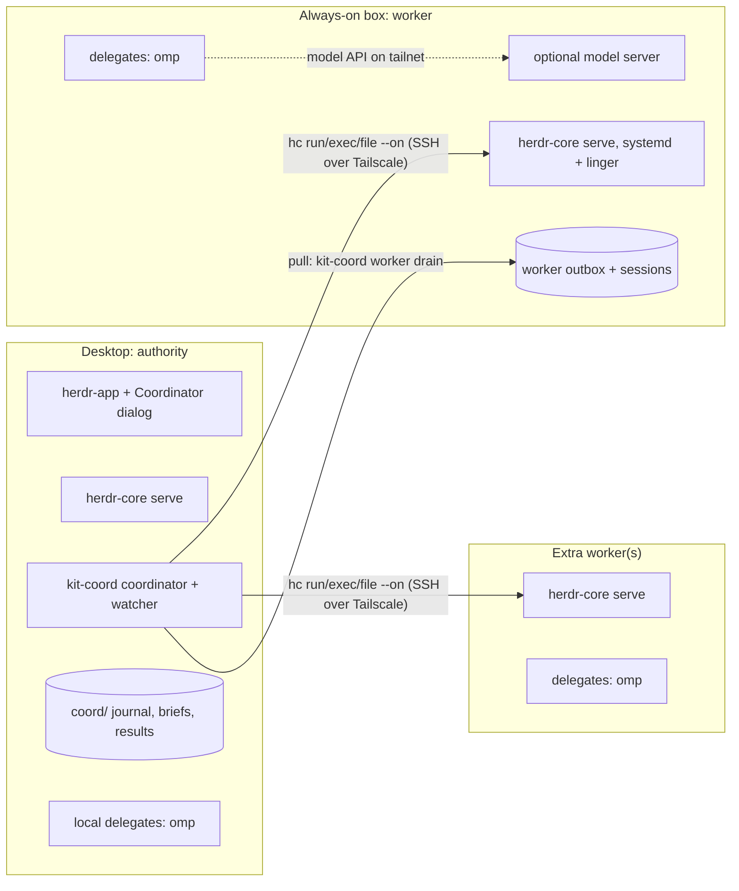

# Distributing coordinator work across machines, deployment and access — plan

Plan, 2026-11-16. Follows [multi-machine-research.md](multi-machine-research.md): **one authoritative coordinator, other machines run delegates through Herdr machines (`hc run --on`).** Nothing here is implemented or tested; remote behaviour of `hc` is taken from installed `hc 0.1.21` help and is [INFERENCE] until the probes below have run.

A refinement of the research: installed `hc` already provides `run --on`, `exec --on`, `file read|write --on` and `machine add|update` over SSH. Through M3 these cover transport, so **no owner API is needed**. That API is only needed later, for clients outside Herdr such as Telegram or a phone.

## 1. What runs where



| Machine | Processes | Must be up for | When it is off |
|---|---|---|---|
| Desktop (authority) | herdr-core, herdr-app, coordinator + watcher, local delegates, the person's UI | new placements, answers, the inbox and cleanup | Nothing is decided. Remote delegates keep working and queue their reports in the worker outbox. On boot, `kit up` autostarts, then the watcher reconciles and drains the outboxes. |
| Always-on box (worker) | herdr-core only (no app), delegates, worker outbox, optional `llama-server`/Ollama on the tailnet | tasks placed on it | Its tasks show `host_unreachable` and are **retained, never released**. The coordinator places new work elsewhere and reattaches or resumes on return. |
| Extra workers | herdr-core, delegates | their own tasks | Same as the box; laptops may sleep freely. |

Repositories, OMP/Git credentials and session transcripts stay on each host. Only briefs (sent out) and result files (pulled in) cross hosts. The model server is optional: omp on any host can point at it. That is the person's own omp config, which herdr-kit does not edit; a user-defined role in `coord/roles/` can select it. Moving the authority to the box is M4 and optional.

## 2. Distributing work

**Placement.** Add one orthogonal flag, `kit task start --on <host>`, recorded on the workstream as its host and inherited by follow-ups:

- Rung 1 is pinned to the host of its session.
- Rungs 2 and 3 inherit the host of the space.
- Rungs 4 and 5 take `--on`; the default is the authority.

Picking a host requires a recorded reason, the same way the ladder does (`--reject-host local="repo not cloned"`). Hosts are entries in `coord/hosts.json` on the authority:

```json
{"box": {"machine": "box", "repos": {"herdr-kit": "/path/to/herdr-kit"},
         "worktree_root": "~/.herdr/worktrees", "roles": ["coord-default","coord-light"],
         "max_delegates": 3, "providers": ["anthropic"], "epoch": 1}}
```

The coordinator chooses the host with three tests:

1. **Repo locality:** the logical repo must be cloned there.
2. **Role and credentials:** the role must be allowed and its provider logged in.
3. **Capacity:** live delegates must be below `max_delegates`. Quota is per host because each host has its own omp login; `kit hosts` can show `hc exec --on <m> omp usage`-style readouts [INFERENCE].

If nothing fits, it asks the person; it never guesses.

**Briefs and results.**

- **Brief:** written locally as today, then copied with `hc file write --on <m> <worker-data>/coord/briefs/<task>.md`.
- **Launch:** `hc run --on <m> --cwd <host path> --label coord.task=<id> --label coord.epoch=<n> -- kit-coord worker exec --epoch <n> -- omp …`.
- **Report:** the delegate runs the same `kit-coord report` command. On a worker data dir (marked by `coord/worker.json`), the report is appended to a local **outbox** together with its terminal ID and a request ID.
- **Collection:** the authority's watcher pulls with `hc exec --on <m> kit-coord worker drain --after <ack>`. It first stores the result contents with `hc file read --on`, then journals `task.reported` and acknowledges.

Pulling means workers never need to reach the authority, reports survive network loss, and request IDs make a redelivered report a no-op.

**Remote release.** Release and reconcile run their Git and terminal checks through a host executor: local `Command`, or `hc exec --on <m> git -C …`. The existing checks are unchanged: dirty, reachable, merged, and process identity. Delegates push branches to the shared Git remote, so reachability is checked after a fetch on the worker. An unreachable host gives the retained reason `host_unreachable`.

**What kit-coord lacks today**

| Gap | Where |
|---|---|
| `RunSpec` has no machine, so `hc run` never passes `--on` | [adapter.rs#L12](../../crates/kit-coord/src/coord/adapter.rs#L12), [#L193](../../crates/kit-coord/src/coord/adapter.rs#L193) |
| Placement targets carry no host; rung 5 only checks for an absolute local path | [place.rs#L183](../../crates/kit-coord/src/coord/place.rs#L183) |
| Spaces, tasks and resources store bare paths and terminal IDs with no host | [state.rs#L104](../../crates/kit-coord/src/coord/state.rs#L104), [#L119](../../crates/kit-coord/src/coord/state.rs#L119), [#L187](../../crates/kit-coord/src/coord/state.rs#L187) |
| A report canonicalizes a **local** result file and resolves its caller from a local `HC_TERMINAL_ID` | [place.rs#L1100](../../crates/kit-coord/src/coord/place.rs#L1100), [caller.rs#L32](../../crates/kit-coord/src/coord/caller.rs#L32) |
| The brief footer embeds the authority's absolute CLI and result paths | [brief.rs#L8](../../crates/kit-coord/src/coord/brief.rs#L8), [place.rs#L569](../../crates/kit-coord/src/coord/place.rs#L569) |
| Session discovery scans a local directory | [launch.rs#L116](../../crates/kit-coord/src/coord/launch.rs#L116) |
| All Git operations are local `git -C` | [git.rs](../../crates/kit-coord/src/coord/git.rs), [release.rs#L138](../../crates/kit-coord/src/coord/release.rs#L138) |
| **Unreachable is treated as gone:** `hc.get(..) == None` releases a tab | [reconcile.rs#L340-L361](../../crates/kit-coord/src/coord/reconcile.rs#L340) |
| An event-stream outage is global, not per host | [watch.rs#L442](../../crates/kit-coord/src/coord/watch.rs#L442) |

## 3. Restartable

| Component | Crash / reboot | Network loss |
|---|---|---|
| herdr-core | Already runs as a `systemd-run` unit with `keeps_running_after_logout` (observed: `hc server status`). On workers, add a persistent user unit, `herdr-core.service` with `Restart=always`, and enable linger so it survives reboot. Programs in kept terminals die on reboot; the terminals come back as shells. | Terminals keep running locally. |
| Watcher | Single instance via the `watcher.lock` flock ([watch.rs#L465](../../crates/kit-coord/src/coord/watch.rs#L465)). Heartbeat every 5 s. `up` replaces a stale watcher ([lifecycle.rs#L173](../../crates/kit-coord/src/coord/lifecycle.rs#L173)). | Probes each host with `hc exec --on m true` and records `host.unreachable`/`host.reachable` events, with backoff. |
| Coordinator | `up --if-enabled` from the activation hook ([activation.rs#L32](../../crates/kit-manager/src/manager/activation.rs#L32)), serialized by `up.lock` ([lifecycle.rs#L61](../../crates/kit-coord/src/coord/lifecycle.rs#L61)). A fresh session reads the board and the handoff note from the journal. If the authority later lives on the box, a person-installed oneshot `kit-coord-up.service` runs the same idempotent `up --if-enabled` after boot. | Not applicable on the authority itself. |
| Delegates | The watcher marks `task.interrupted` when a host is reachable but the labelled terminal is absent. The coordinator resumes on the same host with `--session-of`, using the role's `resume` command ([role.rs#L22](../../crates/kit-coord/src/coord/role.rs#L22)); session files stay on that host. | The terminal still runs and reports queue in the outbox. **Unknown ≠ absent:** host presence becomes three-state (present / absent / unknown), and release refuses on unknown. |

- **Idempotent launch:** the existing intent-before-action record ([state.rs#L197](../../crates/kit-coord/src/coord/state.rs#L197), settled in [reconcile.rs#L91](../../crates/kit-coord/src/coord/reconcile.rs#L91)) gains host and epoch labels. An uncertain `hc run --on` is resolved by `hc ls --label coord.intent=<seq>` on that machine before any retry.
- **No duplicate authority:** on one host, the flocks already exclude duplicates. Across hosts, the `coord/` tree is never synced, and an **authority epoch** is added: every launch and drain carries it, and `kit-coord worker exec|drain` refuses anything below the highest epoch that worker has seen. A desktop that comes back after the authority moved to the box (M4) is therefore fenced out by the workers themselves, without trusting heartbeats. Coordinator lifecycle stays person-only.

## 4. Quick to set up (target: under 10 minutes)

Section 6 defines the deployment itself. The coordinator part adds only `--worker`.

The person does these steps by hand, because they are logins:

1. On the new machine, run `tailscale up --advertise-tags=tag:herdr-worker` (browser login).
2. As the `agent` user, run `omp` once and log in.
3. Add the machine's GitHub credential (§6).

Then one command on the authority:

```sh
herdr-kit machine add box --ssh agent@box --repo herdr-kit=git@github.com:nnexai/herdr-kit.git --worker
```

It runs the §6 bootstrap: the stack at the authority's pinned revision, the core unit and linger, clones, and an auth check. Then, because of `--worker`, it also:

1. Marks the worker data dir with `worker.json`.
2. Writes the host record with epoch 1.
3. Runs a smoke test: `hc run --on box -- kit-coord worker exec --dry-run`.

The command is idempotent and can be re-run. `herdr-kit fleet sync` (§6) keeps the worker binary and `hc` current.

## 5. Milestones

| # | Usable result | Size | Probe first | Riskiest unknown |
|---|---|---|---|---|
| M0 | **Deployment and access only (§6).** Tailscale tags and ACLs, the `agent` user, `herdr-kit machine add` without `--worker`, and `fleet sync`. Machines are reachable with `hc attach`; no coordinator changes. | S, ~2–3 d | P0: on one box, run `herdr-kit install` headless from a detached GitHub clone, then roll forward and back with two shas. | Whether a headless install (core only, no app home) works with today's manager. |
| M1 | **Remote delegate.** `--on` for rungs 3 and 4 on a manually added host, with remote brief, outbox report and result pull. Remote release is retained as `remote_release_manual`, and the person cleans up. | M, ~3–4 d | P1: `hc machine add box --install`, then `hc run --on box --bg --keep --name probe --label coord.task=probe --cwd ~/dev/herdr-kit -- omp --model @smol "reply hi"`. Check `hc get box/tN`, `hc events` working/idle words, `hc send` steering, `HC_TERMINAL_ID` inside, and whether `herdr-app ls` shows the remote space. | Whether labels, `--keep` and the app space/tab view work for remote terminals. |
| M2 | **Host-aware reconcile and release.** Three-state presence, `host_unreachable` retention, remote Git checks, resume on host, epoch-tagged launches. | M, ~1 wk | P2: during P1, run `tailscale down` on the box, then record what `hc get box/tN`, `hc ls --label` and `hc events` return, compared with a truly killed terminal. | Whether "unreachable" and "absent" can be told apart at all. Until they can, [reconcile.rs#L353](../../crates/kit-coord/src/coord/reconcile.rs#L353) must skip remote resources. |
| M3 | **`machine add --worker`.** Registers the host with the coordinator; a new worker machine in under 10 minutes. | S, ~1–2 d | P3: bootstrap a fresh VM by hand with a stopwatch, and test headless omp login. | omp login without a browser, and linger permissions. |
| M4 (optional) | **Authority on the always-on box.** `kit authority move` with an epoch bump; the desktop Coordinator dialog runs through `hc exec --on box kit-coord …`. | L, ~1–2 wk | P4: run herdr-app, or only `herdr-core`, on the box, and run `kit-coord status`/`board` there through `hc exec --on` from the desktop mods. | kit-coord's dependency on herdr-app for spaces ([adapter.rs#L133](../../crates/kit-coord/src/coord/adapter.rs#L133)) on a headless host. |

Order: M0 can ship on its own. For the coordinator milestones, run P1 and P2 before writing any code. If P2 shows that unreachable and absent cannot be distinguished, M1 ships with remote resources excluded from automatic release.

## 6. Deployment and access (standalone, no coordinator needed)

**What a machine gets.**

| Piece | How it is installed | Needed on |
|---|---|---|
| herdr-core + `hc` | `hc machine add <m> --install`, then `hc machine update <m>` copies the desktop's exact `hc` | every machine |
| herdr-app | its normal installer; only machines with a display | desktop/laptops |
| herdr-kit (manager, mods, layout) | `herdr-kit install --source <clone> --app-home …` from a clone of `github.com/nnexai/herdr-kit`; it builds with `cargo` ([build.rs#L192](../../crates/kit-manager/src/manager/deployment/build.rs#L192)) | every machine; mods/layout only where herdr-app runs |
| omp | the same package manager and version as the desktop | every machine that runs agents |
| Toolchains | `git`, rustup (needed by the updater build), plus each repo's own pinned toolchain (`rust-toolchain.toml`, `.tool-versions`) | per repo |

**Source channel and version sync.**

- **Desktop:** keeps the local dev checkout as its trusted source, as today.
- **Every other machine:** uses a plain clone of the published GitHub repo as its source, checked out **detached at an exact commit**. Never track a branch there.

The updater builds whatever `HEAD` the source has ([manager.rs#L186](../../crates/kit-manager/src/manager.rs#L186), [deployment.rs#L264](../../crates/kit-manager/src/manager/deployment.rs#L264)). So "version" means one commit, and syncing means moving `HEAD`.

One command rolls a fleet forward: `herdr-kit fleet sync --rev <sha>` (default: the desktop's current revision). Over `hc exec --on <m>`, it runs on each machine:

1. `git fetch && git checkout --detach <sha>`
2. `herdr-kit update apply`
3. `hc machine update`

It reports per-machine `herdr-kit status`; unreachable machines are listed, not retried in a loop.

A **rollback** is the same command with an older sha. The updater activates it as a new generation; there is no separate rollback path. Superseded generations are swept only once unused (`generations.rs`), so a rollback usually rebuilds. Ship to the desktop first and to the fleet only after it has run there.

**Recommended tool: a kit command plus a ~50-line bootstrap script, not Nix or Ansible.**

- The manager already has a receipted, transactional install/update. `hc` already provides authenticated transport, file copy and remote exec. A configuration-management layer would be a second, competing convention for the same state.
- Nix does not fit `hc update` self-updating, nor a brew-installed omp.
- Ansible adds inventory and Python to keep in sync with Tailscale's own device list.
- chezmoi is optional, and only for the person's own dotfiles. herdr-kit never edits the omp config.

The script is `herdr-kit machine add`: it installs `hc`, rustup, omp, the clone at the pinned sha, `herdr-kit install` (headless: core component only), the `herdr-core.service` user unit and linger.

**Access.**

- **Network: Tailscale ACLs with tags.**
  - Workers join as `tag:herdr-worker`, so they are owned by the tailnet rather than by the person's account, and do not expire with a user's key.
  - Grants: the person's devices may SSH to `tag:herdr-worker` as user `agent`, and workers reach `tag:model-server` on its one port.
  - Workers get **no** access to the desktop or to each other. The pull model in §2 needs none.
- **SSH: prefer Tailscale SSH over key files.** Identity comes from the tailnet ACL, there are no keys to distribute, and revocation is central. Use `check` mode for the person's user and plain `accept` for `agent`, so `hc` can connect unattended. Plain SSH keys are the fallback: one ed25519 key per authority, placed only in `agent`'s `authorized_keys`, never the person's personal key. The client side is unchanged either way, because `hc machine add` simply runs `ssh`.
- **Agent user and sandboxing.**
  - On workers, all agents run as a dedicated unprivileged `agent` user: no sudo, linger on. That user owns its repos, worktrees, omp login and Herdr core.
  - On the desktop, agents keep running as the person, because the GUI and herdr-app integration depend on it.
  - Use a rootless podman container only for untrusted code; it is not the default, since it would break `hc`/omp session paths.
- **Credentials are minted on the machine, never copied.**
  - omp/provider: interactive login on that machine, which gives one revocable session per machine and per-machine quota.
  - GitHub: one **deploy key per repo per machine** (push to that repo only, no API) for plain push. Use a fine-grained PAT, limited to the listed repos with Contents and Pull requests read/write and a 90-day expiry, only where `gh` PR work is needed, via `gh auth login` on the machine.
  - Commit identity: the nnexai noreply address.
  - No secrets in kit-coord state. The Telegram bot token exists only on the single bridge host.
- **Revoking a machine that leaves,** in this order:
  1. Disable its host record: no new tasks.
  2. Collect or retain its open work.
  3. Remove the device in the Tailscale admin, which cuts SSH and the tailnet.
  4. Delete its GitHub deploy keys or PAT, and revoke its omp/provider sessions.
  5. `hc machine rm <m>`.
  6. Wipe `/home/agent` if the hardware is reused.

  Because nothing was copied, no other machine needs a credential rotation.

**Reaching the UI from another device.**

- **Coordinator dialog:** the mods execute a local `kit-coord` and watch the local journal ([status store](../../mods/kit-coord/store.js), [dialog store](../../mods/kit-coord-ui/store.js)). On a laptop they therefore show the laptop's empty data root. A configured authority machine could make the mods run `hc exec --on <authority> kit-coord …` and poll instead of `watchFolder`. This is the same change M4 needs. Until then, attach to the coordinator terminal with `hc attach <authority>/tN` over Tailscale SSH [INFERENCE: untested].
- **Telegram:** there is no code yet. Plan one bridge process on the authority, or on the always-on box once it is the authority. It long-polls outbound, so it needs no inbound port, accepts only the allowlisted user ID, sends `Needs you` questions once per episode, and turns replies into person input. It is useful for answering, not for reviewing work.
- **Not used:** Tailscale Funnel and public ports. A later read-only web view would be tailnet-only, via `tailscale serve`.
