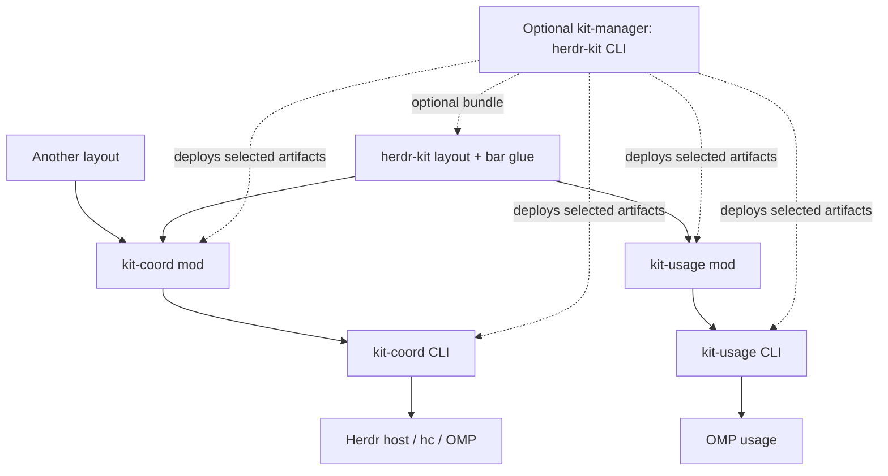

# herdr-kit modular monorepo: feasibility, package design and cutover

Status: decision proposal only; no extraction or deployment authorized.
Evidence baseline: main at `8afa371dc185deeb27027c00b270b5a39971cf17` (2026-11-13).
Source references below refer to that baseline, not to future file locations.
“Observed” means source/history or the explicitly listed local commands; “Proposed”
means a design decision, not an implemented or verified capability.

Scope expanded after the initial coordinator-only proposal: split the whole
repository into independently usable capability packages, with the herdr-kit
layout composing them. **Primary acceptance: another person's layout includes
kit-coord with no kit-usage, herdr-kit layout, or installed suite updater.**
The original coordinator safety/path findings still apply. All target package,
command and distribution examples below are proposals, not existing commands.

## 1. Current shape and couplings

### Observed component map

| Piece | Current owner and evidence |
|---|---|
| CLI | One package/binary, no workspace or shared library crate (`Cargo.toml:1-22`). `src/main.rs:1-4,20-24,73-117` embeds coord, uses its `Output` type even for suite commands, and dispatches `herdr-kit coord …`. `src/coord/cli.rs:18-178` defines up/down/status/restart/handoff, board/log/explain/inbox/roles, workstreams/tasks/release, decisions/questions/instructions/threads/corrections/scouting, reports/notes/stats/ratings/config and watch. |
| Coordinator engine | `src/coord/mod.rs:3-25` owns adapters, briefs, caller resolution, CLI, config, journal/fold/state/kinds, Git, placement/launch/release/reconciliation, roles/rules/stats/views, lifecycle and watcher. The engine talks to `hc` and `herdr-app`, not usage (`src/coord/mod.rs:31-63`). |
| Visible watcher | `src/coord/lifecycle.rs:246-262` launches the CLI's `coord watch` in a named watcher tab in the coordinator space. `src/coord/watch.rs:420-513` takes an exclusive watcher lock, consumes managed-terminal events, ticks each second, heartbeats every five seconds, and reconciles on the configured interval. It is not a hidden daemon. |
| Persistence | `src/coord/paths.rs:25-42` builds every path under `<suite-root>/coord`: `journal/`, `state.json`, `lock`, `up.lock`, `watcher.lock`, `heartbeat.json`, `config.json`, `briefs/`, `results/`, `sessions/`, `roles/`, `home/`; terminal-specific locks additionally live in `coord/locks/` (`src/coord/paths.rs:96-119`). Journal files are monthly JSONL; cached state is replayable (`src/coord/journal.rs:57-74,149-170`). Journal format is 1 and fold version is 5 (`src/coord/kinds.rs:8-23`; `src/coord/state.rs:12-35`). |
| Board, Timeline and “inbox” UI | Already a separate native GPUI JS mod, `mods/herdr-kit-coord`, not Rust GPUI code. Its entry imports only its own modules plus host APIs (`mods/herdr-kit-coord/main.js:1-9`). Board and Timeline share the Coordinator overlay (`main.js:14-18,45-50`; `ui-board.js:25-45`). The CLI inbox is the agent's pending-event/ack protocol; the dialog does **not** execute `coord inbox`: store reads status/board/log (`mods/herdr-kit-coord/store.js:45-76`). Do not add another inbox surface. |
| Mod lifecycle/status | The first status-strip copy owns polling, journal watching and `nextCommand()` (show, timeline, restart, focus and navigation); overlay copies refresh their visible data (`mods/herdr-kit-coord/main.js:24-42`). Store publishes `herdr-kit.coord.status.v1`, conditionally autostarts, and invokes up/restart (`store.js:5-6,95-120,131-169`). Status rendering uses mod-local icons (`ui-status.js:3-5,33-39`). |
| Layout | `layouts/herdr-kit.json:170-189` already adds the coord mod using `content.mod`, just as tabs/files/changes are referenced (`:89-98,150-162`). The current 28px status row has a flexible usage block followed by a separate 80px coord block. The proposal is **not** inventing mod support; it completes backend/distribution independence. |
| Usage bar | No cross-mod JS imports or direct calls into the coordinator. Usage owns the left indicators and its Limits readout, with provider omitted below its measured width of 500px (`mods/herdr-kit-usage/main.js:59-99`). It starts suite update maintenance at startup/every six hours (`:27,55-58`), so usage indirectly updates/restarts the coordinator through the suite release. |
| Post-activation | `src/main.rs:97-115` invokes `coord::lifecycle::after_activation` only after an activating install/update, including rollback. The hook checks for coord config, then runs `<root>/bin/herdr-kit --data-dir <root> coord up --if-enabled`, with a 120-second bound (`src/coord/lifecycle.rs:738-783`). Delegate refusal is skipped/forbidden_caller, not failed; other failures remain failures. |

### Complete extraction-boundary inventory

* **Rust/package boundary:** production coord code reaches outside its subtree only
  for `crate::manager::stable_binary` and `crate::paths::data_dir` in
  `src/coord/mod.rs:82-96`, and `crate::manager::active_release` in
  `src/coord/lifecycle.rs:56-58`. The reverse dependencies are the CLI dispatch,
  shared output/error handling and activation hook in `src/main.rs:73-117`.
  There are no shared workspace crates today. Normal dependencies are the root's
  anyhow/clap/serde/serde_json/fs2/sha2/tempfile/rustix/tokio set
  (`Cargo.toml:8-17`); keep only those actually needed by each resulting package.
  Test-only `crate::coord` imports and relative capture `include_str!` paths must
  move with the engine (`src/coord/brief.rs:87-90`;
  `src/coord/adapter.rs:481-484`; `src/coord/reconcile.rs:413-417`).
* **Root/config/environment:** root CLI supplies `--data-dir` / `HERDR_KIT_DATA_DIR`
  (`src/main.rs:13-15,89-92`). Defaults are XDG/Linux or macOS suite paths
  (`src/paths.rs:4-27`). Coordinator config is separate from updater state and
  contains autostart, coordinator role, timers and worktree root
  (`src/coord/config.rs:9-35`). External executable overrides are
  `HERDR_KIT_HC` and `HERDR_KIT_HERDR_APP`
  (`src/coord/adapter.rs:211-214,323-326`). Caller identity comes from
  `HC_TERMINAL_ID` and live `coord.*` terminal labels, not executable naming
  (`src/coord/caller.rs:36-84`). Preserve the permission matrix: up/down/restart,
  config and rate are person-only; report/note are delegate-only
  (`src/coord/mod.rs:162-184`). Never clear caller identity to make the hook work.
* **Updater ownership/pinning:** `src/manager.rs:19-20,195-201` hard-codes both mod
  bases, suite layout, release directory and the sole stable binary. Manager
  state holds current/previous revisions, file-hash receipts, managed generations,
  source/app home and maintenance time; its activation journal has only one old
  binary hash (`:22-41`). It archives committed local source and builds only
  `--bin herdr-kit` (`:351-368`). It copies known mods, text-rewrites both names,
  and injects identical suite BINARY/DATA_DIR/RELEASE/MOD_NAME bindings into each
  (`:369-384`). Release and installed assets are hash-verified, with collision/
  drift refusal (`:263-310`). Rollback activates retained assets (`:461-472`).
* **Release identity is operational, not cosmetic:** lifecycle reads the suite's
  root `state.json.current` through manager (`src/manager.rs:409-413`;
  `src/coord/lifecycle.rs:56-58`). Watcher compares that identity at heartbeat,
  writes `watcher.stopped/release_changed`, then execs **the stable herdr-kit with
  `coord watch`**, keeping its terminal (`src/coord/watch.rs:414-417,515-551`).
  `up` also requests a coordinator handoff when its session's release differs
  (`src/coord/lifecycle.rs:560-590`). Merely moving files breaks both edges.
* **Prompts/session paths:** `Ctx::cli_argv` prefers the installed stable binary,
  falls back to current_exe, and includes the explicit nondefault data root;
  `Ctx::cli` shell-quotes it (`src/coord/mod.rs:74-96`). The hard-coded **suffix**
  `coord` comes from `src/coord/brief.rs:5-18,38-60`; `kit coord …` wording is also
  embedded in `src/coord/roles/coord-main.md:12-18,75-109`. The absolute binary is
  generated, not fixed in the role file. Coordinator launch combines that role,
  generated CLI and startup read (`src/coord/lifecycle.rs:304-339`). Delegate
  first/follow-up messages use the same CLI/result renderer
  (`src/coord/place.rs:474-480,799-814`). There is also a watcher rule's literal
  “using coord report” (`src/coord/rules.rs:41,254-258`). Built-in roles are
  compiled from `src/coord/roles/`; override files win by name
  (`src/coord/role.rs:37-44,61-70`). Documentation duplicates the main role
  (`docs/coordinator/roles/coord-main.md:1-18`).
* **JS/protocol/assets:** development coord runtime still says BINARY=herdr-kit,
  DATA_DIR=null and MOD_NAME=herdr-kit-coord
  (`mods/herdr-kit-coord/runtime.js:1-4`); generated installed runtime instead
  uses an absolute immutable suite binary. All store argv includes `coord`, and
  errors name herdr-kit (`store.js:45-76,136-153`). JSON schema decoders and
  shared-state key are public integration contracts (`model.js:14-20`;
  `store.js:5,95-98`). Updater's global replacement also rewrites names inside
  JS/JSON, so changing the mod base without reviewing cache keys is unsafe
  (`src/manager.rs:226-234`). Keep self-overlay/icon paths generation-correct.
* **Tests/docs/tooling:** integration harness pins `CARGO_BIN_EXE_herdr-kit`,
  legacy env names and the `coord` argv component (`tests/coord_cli.rs:13-17`).
  Native model/store tests live in `tests/coord.test.js` and
  `tests/coord-store.test.js`; manager layout/runtime tests live in
  `src/manager.rs:546-664`. README's single-tool policy explicitly rejects helper
  executables (`README.md:3-6,167-177`): this decision must intentionally replace
  that policy and update CLI examples, recipe, spec, implementation plan and role
  documentation, not leave contradictory guidance behind.

### History and observed feasibility probes

`e67f5c0` introduced the whole coordinator and separate mod; `46e5684` fixed
forbidden-caller activation reporting; `7dc3c3f` corrected the 80px layout contract;
`8afa371` fixed a new live coordinator falsely being ended by stale watcher facts.
The last fix explicitly rechecks hc before recording loss
(`src/coord/watch.rs:270-289,1183-1284`); preserve this behavior during moves.

Read-only CLI help on the existing checkout release binary reproduced the full
`herdr-kit coord` surface. A disposable HOME/data root, seeded from the repository's
12-line journal fixture, returned board schema 1, seq 12, workstream ws-k3m2ab and
task ws-k3m2ab-t1; inbox returned cursor 0, last_seq 12, pending 1. The journal
remained byte-identical. No live coord reads/writes or actors were needed.
Evidence is ignored under `evidence/coord-standalone/` (help, read-model/inbox JSON
and scenario note). `herdr-app check` on a nonexistent path in a temporary app
home exited 1 (“does not exist”); this proves an installer can detect absence,
**not** that a running layout handles a removed mod gracefully. Rust LSP navigation
was attempted but its server exited; boundary claims above use direct source reads.
No new binary, updater execution or native UI migration was tested in this plan.

### Whole-repository inventory and proposed ownership

| Current component | Proposed package / destination | Boundary and evidence |
|---|---|---|
| `src/coord/` including every engine module, built-in roles and testdata | `kit-coord`: `crates/kit-coord/src/coord/` plus its CLI main | All coordinator behavior stays together; no usage dependency. Components and outward symbols are enumerated above. |
| `mods/herdr-kit-coord/`: main, store, model, Board, Timeline, status, four icons, manifest/runtime | `kit-coord`: `mods/kit-coord/` | A real standalone package contains both CLI and native mod. Rename the mod base once, update generated MOD_NAME/assets/overlay references atomically; no old-name alias. Current imports/self-opening overlay are in `mods/herdr-kit-coord/main.js:1-9,45-50`. |
| `src/usage.rs`, `src/usage/{parse,cache,source,tests}.rs` | `kit-usage`: `crates/kit-usage/` | Own anonymous schema, projection, scheduling, OMP subprocess, private cache and collector lock. There are no production `crate::coord` or manager imports in this subtree (`src/usage.rs:1-10,143-176`; `src/usage/source.rs:37-60`). |
| `mods/herdr-kit-usage/{main,model,runtime}.js`, mod.json | `kit-usage`: `mods/kit-usage/` | Own Limits readout/details, formatting and shared usage snapshot. Remove suite maintenance, currently `mods/herdr-kit-usage/main.js:27,55-58`. Keep snapshot version 1 and all distinct unavailable/stale/zero/unlimited states (`src/usage.rs:55-93,264-317`). |
| Machine/branch/agent indicators and branch/server/monitor icons currently in the usage mod | Layout's small `mods/herdr-kit-bar/` integration view; retain tiny local chrome helpers/icons where needed for kit-usage's standalone full-bar view | These are host/workbench chrome, not quota collection (`mods/herdr-kit-usage/main.js:85-99`). Do not manufacture a shared runtime mod just to share three tiny icons/host labels. |
| `src/manager.rs` and suite install/source/status/update CLI | Optional `kit-manager` Rust package in `crates/kit-manager/`, retaining executable name `herdr-kit` | Manager owns trusted source, selected-package builds, receipts, activation/recovery, drift refusal, rollback and optional maintenance. It is not owned by a layout or a capability. Keeping the existing installer executable name avoids unrelated installer renaming; final CLI has no coord/usage subcommands. |
| `src/main.rs` CLI dispatch, common Output/error handling | Three entry points: kit-coord, kit-usage, manager's herdr-kit | Coordinator keeps its text/JSON/error contract; usage and manager return their own results. Do not retain a dependency on coord::Output for unrelated commands (`src/main.rs:73-117`). |
| `src/paths.rs` platform data root | Tiny private helper in each binary that needs it; identical compatibility semantics | Only 28 lines today (`src/paths.rs:1-28`). Copy this small policy with shared fixture cases; no mandatory kit-core library. Each explicit package env is separate; manager invokes packages with an explicit root. |
| `layouts/herdr-kit.json` | `herdr-kit` layout asset package, not another Rust capability | Composition plus a lock/manifest for selected packages. Existing stock references workspace-chrome/spaces/agents/tabs/pane/files/changes remain Herdr-owned, not vendored kit packages (`layouts/herdr-kit.json:30-81,89-98,124-127,150-162`). |
| Usage-mod suite-maintenance timer; main.rs post-activation hook | Timer moves to layout integration or explicit manager invocation; hook stays manager-side as a bounded kit-coord subprocess adapter | No kit-usage code may update other components. The manager invokes the hook only when coord is selected/activated; no direct crate dependency (`src/main.rs:97-115`; `src/coord/lifecycle.rs:738-783`). |
| `tests/coord_cli.rs`, coord JS/store tests, `tests/fake/cli.sh`, coordinator captures | kit-coord tests/fixtures; only genuine installer cases stay with kit-manager | Update binary/env/argv assumptions (`tests/coord_cli.rs:4-17`); keep role examples/spec beside their capability. |
| `tests/usage.test.js`, `src/usage/tests.rs` | kit-usage tests | Anonymous projection, caching/lease, symlink/output bounds and JS quota calculations remain capability-owned (`src/usage/tests.rs:11-37,41-101`; `tests/usage.test.js:3-38`). |
| Manager layout/runtime tests | Separate manager deployment tests and layout composition contracts | Current mixed tests are at `src/manager.rs:546-664`; test real owned-artifact behavior, not cross-package source text. |
| Cargo.toml/Cargo.lock, package.json | Workspace build/test metadata, one lockfile; per-package narrow test entry points | Today Cargo is one package and Node just runs all pure tests (`Cargo.toml:1-22`; `package.json:1`). Shared third-party dependencies are not a reason to invent kit-core. |
| README, RECIPE, CHANGELOG, LICENSE, preview, docs/coordinator* | Root catalog/build/release policy plus package-specific usage/design docs; preview belongs to layout | Update the single-binary policy and examples at each capability cutover (`README.md:3-6,167-179`; `RECIPE.md:46-65`). Keep historical evidence distinguishable from active instructions. |
| Generated d.ts/jsconfig; target/dist/evidence; installed journal/config/layouts | Not distributable source packages or kit-core | Host-generated contracts and build/evidence artifacts stay ignored. Existing live state remains where it is; installation ownership does not imply ownership of user data/settings. |

Usage-specific boundaries are already strong: OMP executable discovery is private
to usage (`src/usage/source.rs:5-14`), collection is bounded/redacted
(`:37-60`), and its cache uses pinned-directory no-follow/owner checks
(`src/usage/cache.rs:17-47,51-73`), unlike manager's deployment path handling.
Do not unify these different security policies into a generic “safe filesystem”.
The explicit usage override currently comes from `src/main.rs:53-62`; the CLI
passes `<root>/usage` to the collector (`src/main.rs:99-102`).

An additional disposable CLI probe used a fake OMP executable, not real credentials:
two usage reads yielded schema 1, Copilot available, used=4, exactly one source
invocation, no projected fixture identity and no coordinator directory.
`evidence/coord-standalone/usage-independence.json` records this. Temporary source
script/data were removed. This establishes the current collector's independence,
not proof that the proposed extracted package or native combined bar exists.

## 2. Target packages, dependencies and distribution

### Decisions and rejected alternatives

**Recommend `kit-usage`**, with the user-facing label **Limits** unchanged.
“Usage” matches `omp usage`, the current module/protocol, and the actual scope:
consumption, remaining allowance, credits, reset windows and estimates, not just
hard limits (`src/usage.rs:55-93`; `RECIPE.md:14-17`). `kit-limits` would be a
reasonable narrower product name, but buys little and suggests enforcement the
tool does not perform. Do not create both names or aliases.

**Do not create kit-core initially.** The only proven shared Rust policy is the
small platform data-root helper. Both capabilities have different state, errors,
locks and subprocess/security needs. Share Cargo dependency versions, documented
deployment/readout schemas and fixture cases, not a mandatory runtime service or
catch-all crate. Small private path/JSON-publication helpers are preferable to
cross-package lifecycle coupling. Reconsider a **private library only** if a
second real consumer needs the same nontrivial implementation and invariants.
It must contain no coord/usage logic, updater policy, auth, daemon, UI lifecycle
or global state; it would be a leaf dependency, never a mod everyone must install.
Nothing in this plan requires shipping or downloading kit-core.

| Option | Benefits | Decision / cost |
|---|---|---|
| Same-repo kit-coord + kit-usage + optional kit-manager + layout assets; no kit-core | Independent reuse, one source trust root/lockfile, local coordinated changes, narrow ownership | **Choose.** More package receipts/activation tests; no runtime package coupling. |
| Same packages, kit-core first | One place for shared helpers | Reject speculative foundation: only a tiny path policy is proven common; security/state policies differ. An empty framework delays the actual other-layout use case. |
| Separate repositories/updaters | Independent governance/releases | Reject now: extra trust roots, compatibility/release machinery and competing update ownership without a demonstrated need. |
| Keep one executable and rename only the JS | Small diff | Reject: both UIs are already separate mods; leaves backend/update dependencies and fails the primary acceptance. |

Proposed source tree: `crates/{kit-coord,kit-usage,kit-manager}/`,
`mods/{kit-coord,kit-usage,herdr-kit-bar}/`, `layouts/herdr-kit.json` and explicit
package/bundle manifests. kit-manager still produces `herdr-kit` for source,
install/status/update operations; kit-coord produces `kit-coord`; kit-usage
produces `kit-usage`. Final manager code contains no embedded capability engines.
The layout asset package has no Rust binary. Publish/build capabilities separately
without requiring a layout install; the full suite is just one selected bundle.

### Acyclic dependency graph

Arrows mean “uses/selects”, not “starts a service”. There is no reverse dependency
from a capability to a consumer layout, updater or the other capability.
Manager edges are artifact/deployment contracts, **not Rust imports of engines**.
The optional install tool is deliberately outside the runtime graph.

Neither kit-coord nor kit-usage depends on kit-manager at run time, nor on each
other at build time or run time. A shared protocol **producer** does not depend
on its optional layout **consumer**. There are no imports between mod directories.
Shared third-party crates and host APIs are ordinary leaf dependencies.

### Distribution: coordinator in somebody else's layout

**Proposed canonical flow**, explicitly not today's CLI:

1. Select a full committed Git revision and package `kit-coord`. An optional
   one-shot manager install uses
   `herdr-kit install --component kit-coord --revision <full-commit> --source REPO --app-home APP_HOME --data-dir R`.
   It installs **only** kit-coord assets: no usage, herdr-kit layout/bar, key or
   setting changes; it does not switch the consumer's layout or start actors.
2. Install immutable `R/releases/<commit>/kit-coord` and
   `APP_HOME/mods/kit-coord-<commit>/`; generate its local runtime with absolute
   BINARY, explicit DATA_DIR=R, RELEASE and matching MOD_NAME. The mod carries all
   its own JS/icons; no suite files or cross-directory imports. A stable
   `R/bin/kit-coord` supports prompts/people. No PATH/shell changes are required.
3. Return the exact resolved module name to the integrator. Their layout uses
   `{"content":{"mod":"kit-coord-<full-commit>","props":{"view":"statusbar"}}}`
   in an appropriately sized block. Its status view owns polling/command receipt;
   click opens its own Board/Timeline. The generated package-specific metadata
   and docs explain off/start behavior before any person enables autostart.
4. Keep that layout pin until its owner chooses to upgrade it. Installing a newer
   generation does **not** text-rewrite another person's layout. No floating
   “latest” folder or module-name alias. The external layout's own manifest/lock
   is authoritative for its pin; a bundled herdr-kit layout has its own lock.

Mod and CLI must be a matching generation, not independently floating versions.
Use full Git revision pins initially, with package identity plus protocol versions;
human package versions may remain aligned. Bundle defaults can pin all packages
to one source revision; independent consumers can choose different package pins
whose readout/deployment protocol is supported. Do not introduce a registry,
remote downloader/signing claim, compatibility solver or separate self-updaters.
Keep committed-source builds, locked dependencies and hash/drift refusal.

**With no installed updater:** the external layout owner is the update owner.
Provide a documented component source/export artifact and deterministic runtime
template. They may build only `cargo build --locked --release -p kit-coord`,
install the CLI/mod generation with their own installer, and supply its explicit
runtime/data paths; or run kit-manager once from source to stage/install it and
not retain an updater executable/service. Neither mode installs the herdr-kit
layout. If they choose the former, they own pin/hash validation, atomic publication
of any active descriptor and rollback; there is no automatic update or silent
fallback to herdr-kit. A fixed manually installed component without an active
deployment descriptor stays on its embedded revision; it does not discover suite
manager state. Upgrades can be a quiescent replacement if its owner does not
implement managed descriptor publication.

**With kit-manager:** update only its selected owned set. Per-package receipts,
current/previous selections and deployment descriptors replace the assumption of
one current binary. It may stage a newer external-layout pin and return new
references, but must not activate a mismatched CLI/UI generation or edit an
unowned layout. The consumer's installer coordinates reference activation and
descriptor publication, or the person performs the documented paused transition.
Reject two owners updating the same installed package/root; transfer ownership
explicitly, never adopt collisions or overwrite drift. Separate app homes/roots
are the clean choice for independently pinned simultaneous consumers; the same
coord data root intentionally means the same singleton coordinator, not one per
layout. Do not dual-run different coordinator generations against one journal.

### Update ownership, release readiness and the hook

The updater is the optional **kit-manager package**, not kit-core, not part of
kit-usage and not intrinsic to the layout JSON. The herdr-kit bundle includes it
for convenience and a tiny layout-owned maintenance invocation, retaining the
current daily scheduling/backoff/lock semantics. An external-layout-only install
defaults to **explicit owner updates**, with no maintenance timer unless that
owner deliberately opts into the manager. No mod installs code on its own.

Remove the usage-mod timer only when its replacement is present in a deployable
suite release. Keep the final manager executable/stable path `bin/herdr-kit`;
remove `coord` and `usage` subcommands at their respective clean cutovers.
The updater's own trusted atomic replacement remains the only live suite install
mechanism. Code must never overwrite a running installed binary in place.

Preserve a small versioned coordinator deployment descriptor at
`R/kit-coord/active.json`, outside its unchanged journal tree. Minimum contract:
schema version, selected coordinator revision and absolute immutable executable.
Package receipts also bind its resolved mod generation. Embed each executable's
actual build revision; do not infer the running binary solely from a mutable
pointer. The coordinator reads this public descriptor, not kit-manager's private
State. Missing/invalid desired targets must yield degraded health while retaining
the running watcher, not a repeated failed exec.

Generalize manager activation journal/hash ownership to the selected binaries,
mods, descriptors and **only the layouts it owns**. Stage/verify immutable assets
first, install stable binaries and selected mod/layout references, then publish
the coordinator-ready descriptor. Record all old/new hashes for idempotent crash
recovery; rollback publishes a complete prior selected set. Preserve old one-bin
receipts/activation journals as readable migration/rollback inputs. Do not delete
retained mod generations or treat user layout state as owned deployment state.

Watcher replacement becomes descriptor target + `--data-dir R watch`, never
`herdr-kit coord watch`; preserve the exclusive singleton lock/visible terminal.
It reacts to the **selected coordinator revision**, not arbitrary usage/manager
state. A usage-only selected-package update must not restart it. A bundle update
that deliberately advances every package's source revision still advances coord
and may request a handoff: changing the package boundary does not eliminate that
release-change cost.

The manager's narrow bounded activation adapter executes selected kit-coord
`up --if-enabled` only when appropriate; preserve caller environment, disabled,
skipped/forbidden_caller and real failed states. No direct Rust engine dependency.
An absent/unselected coord package is skipped, not an update failure or an
assertion that a coordinator was started. Standalone kit-coord works without
ever invoking this hook; existing mod/CLI autostart rules remain its own.

### Standalone and combined behavior

| Installation / surface | Required behavior |
|---|---|
| kit-coord alone in another layout — **primary** | Its 80px status view polls/caches, accepts registered commands and opens Board/Timeline using only its own binary/assets. Off is meaningful and person-startable; no usage import, quota subprocess, updater, suite layout or hidden helper is required. Watcher/coordinator remain visible Herdr terminals with existing guards. |
| kit-usage alone | Its readout/details and optional standalone full-statusbar view use only kit-usage + OMP. No coordinator probe, repair/autostart, watcher or suite maintenance. “Limits” stays the label; not signed in/missing OMP/stale remain explicit. Current privacy/cache pacing and local-machine semantics are preserved. |
| Both capabilities in a third-party layout | The layout may place their independent views side by side. No install-order dependency or command routing through one capability to the other; matching per-component pins and caller identity are sufficient. |
| herdr-kit bundle, both enabled | Layout integration owns one responsive 28px bar: flexible ellipsized left chrome, then the 80px coord item, then Limits flush right with a normal gap. Normal Limits includes provider; below 500px it omits provider, not the value. One view measures the real row width. Capability lifecycle remains in each mod/CLI, not the bar. |
| herdr-kit without coord | Omit its slot/source binding; usage and host chrome fill the row normally, with no dead 80px gap, missing import or coord calls. |
| herdr-kit without usage | Omit Limits/source binding; coord remains right-aligned and independent; no OMP collector runs. With neither capability, render only workbench chrome. |
| No kit-manager | All chosen capabilities still work; no background update checks. The layout/package owner performs explicit updates. Missing updater must not make a working readout “failed”. |

For the single combined view, a **layout-owned** `herdr-kit-bar` reads bounded
presentation snapshots published by the active capability mods and dispatches
their existing registered commands. It imports neither mod's source and owns no
collector/watcher lifecycle. Each producer can publish full/compact readout text,
accessible label, icon identity, update time and command in a small documented
schema; validate the binding against the selected generation. The layout owns
bindings to these snapshots, so neither producer knows about the other. The bar's
coord icons live in its own directory, not a cross-mod import. Formatting remains
producer-owned; small host-chrome rendering duplication is cheaper than kit-core.
Keep current cached protocol keys/JSON models compatible during moves; give
presentation keys stable literals, never blanket-rewrite them with mod generations.

The producer lifecycle copies must actually be mounted/initialized for polling
and commands, even when the bar renders their summaries. A source-only view in a
shown layout block is an implementation candidate, **not proven host behavior**.
Herdr starts a copy only the first time it shows; hidden copies then keep timers,
and commands reach shown copies only
(`~/.config/herdr-app/AGENTS.md:821-826`). P4 must prove the carrier's visibility,
zero-space rendering and command routing in a real native fixture before this
combined form ships. Do not assume a never-shown hidden node initializes, add an
invisible daemon, or move lifecycle into the bar to work around the host. Retain
the prior working visible composition until that native acceptance passes; the
whole final phase is gated, not a knowingly degraded new release.

### Absence and host API constraints

* Missing/bad kit-coord binary: show unavailable/stale data, retain last good
  board, disable lifecycle/destructive actions until healthy validated status,
  allow retry. Never fall back to herdr-kit coord, impersonate a person, download
  code or spin on errors. Existing exec catch paths are the starting point
  (`mods/herdr-kit-coord/store.js:56-64,114-120`).
* Missing kit-usage binary/OMP: unavailable or explicitly stale cached quotas,
  never fake zero or signed-in data. No coordinator impact. Preserve private
  bounded source handling and collect.lock semantics.
* Intentionally omitted mod: compile the owned layout without its node/source/
  presentation bindings by structural JSON generation. A selected required
  package missing artifacts is an install refusal, never partial activation.
* Unexpected removal of an installed mod: native fixture must prove other
  surfaces survive. Do not infer this from `check` rejecting a nonexistent path.
  There is no documented general `content.mod.optional`/fallback field. If native
  isolation fails, an integration fallback/host fix is a release blocker; do not
  publish the guarantee. Managed drift refusal remains independent of graceful UI.

The existing layout format composes folder-named mods; it is not a dependency
installer/version resolver. Host APIs already provide exec, overlays, shared state
and `<mod>.<command>` delivery (`mods/herdr-kit-coord/gpui-kit.d.ts:22215-22219,22283-22286,22544-22576,22601-22626`;
ignored generated contract, never commit it). No known blocker to the primary
standalone status view. General missing-mod isolation and combined carrier
mounting/command delivery are unproven native gates. Do not add keybindings or a
command-palette feature; reuse the existing actions.

## 3. State, commands and clean migration

### Keep data independent of package installation

Keep `--data-dir R` meaning the existing parent root; preserve Linux/macOS default
parent paths. Existing coordinator data remains `R/coord` and usage data remains
`R/usage`. Branding in a legacy storage path is compatibility, not a dependency
on the herdr-kit executable/layout. Never rename, copy or rebase the coordinator
journal, role overrides, briefs/results/home/sessions/locks or embedded absolute
paths and IDs. Keep journal format 1, fold version 5 and read schemas. Preserve
usage persisted schema 2, public schema 1, `snapshot.json`, `collect.lock` and
private ownership/mode/no-follow policies; do not make its cache a core service.

Use package-specific explicit envs: KIT_COORD_DATA_DIR/KIT_COORD_HC/
KIT_COORD_HERDR_APP and KIT_USAGE_DATA_DIR/KIT_USAGE_OMP_EXECUTABLE. Manager retains
its HERDR_KIT_DATA_DIR contract and passes explicit roots to components.
Default-path compatibility does not require old capability env aliases.
User overrides are identified at preflight and deliberately migrated; do not
silently accept both command namespaces/env sets indefinitely.

Only `kit-coord <operation>` and `kit-usage snapshot …` remain for capabilities.
Remove the legacy `coord`/`usage` namespaces from manager when the corresponding
vertical phase migrates **all** callers. `kit-coord --data-dir R report …
--result R/coord/results/TASK.md` is the report contract. Keep HC_TERMINAL_ID and
coord.* ownership labels; no permission relaxation for new executable names.
Each package main owns its own error/output contract instead of coord::Output.

Regenerate coordinator commands through one argv builder, shell-quoting only for
text. The absolute installed command comes from Ctx::cli_argv, while the suffix
and prompt vocabulary are in brief.rs and role bodies (section 1). Update all
first/follow-up/resume footers, reminders, startup read/truncation, role copies,
watch argv, mod store, hook and examples atomically. Retain `kit` shorthand only
if it expands to the complete kit-coord command, never “kit coord”. Custom role
overrides remain the person's files; flag obsolete command text before use,
never rewrite saved historical briefs/transcripts. Move roles and fixture paths
with each package, retaining OMP model-role selection and session model on resume.

Usage cutover changes source discovery/env producer, CLI argv and runtime together.
Readouts/details keep the same data/privacy meaning; maintenance moves out only
with a working replacement. No usage process should learn coordinator commands
or updater ownership.

### Coordinator continuity requires a planned boundary

The old watcher compiled in `bin/herdr-kit coord watch`; old agents have the old
report command in context. A new file/package cannot rewrite those live processes.
Choose a short **person-owned drained cutover** for the coord phase: finish/record
current work, settle active delegates, persist instructions/open threads and drain
the inbox; person runs old coord down, which disables autostart and stops both
coordinator and watcher. Leave workstreams, resources and saved sessions intact.
Activate the complete new package/bundle, then person runs kit-coord up. The new
coordinator reads the same durable journal; resumed delegates get a new footer.
No core restart, user-space closure or terminal typing.

This is durable continuity, **not uninterrupted process uptime**. If zero pause
is required, approval of a separate explicit handoff mechanism is needed; no
claim that a hot rename is safe. Do not keep a CLI shim/alias or dual-run old/new
coordinators. Retained immutable releases are rollback artifacts, not active
compatibility commands. Reverse rollback also quiesces new sessions before the
old CLI is reactivated. Delegates/coordinator may not run person-only lifecycle
commands or bypass the refusal. Later usage/layout-only changes should not
require this namespace migration again.

### Bootstrap, updater drift and external-layout pins

The installed old builder knows one executable and old mod bases
(`src/manager.rs:365-377`). It cannot safely discover this extraction from a new
commit using its old packaging logic. Before each incompatible source cutover,
the person freezes trusted source intake on a local snapshot at the known working
commit via existing `source --repo`; unchanged frozen HEAD remains safe even when
the due timer resets (`src/manager.rs:450-456,474-483`). Wait out any manager work.
This is temporary release control, not a second product repo. Do not rely on
maintenance “probably not being due” or edit state JSON by hand.

Use the newly built, verified manager's trusted-source install for the first new
artifact format, not old update apply or direct writes into live bin. Subsequent
phases use the already-capable manager but still obey selected pins and explicit
cutover approval. The manager's own binary retains its installed name/path so
this split does not add a second installer rename.

For another layout, updating package bits is not permission to edit its layout,
change its pin or transfer its ownership. Owner-controlled activation must bind
matching mod/runtime/CLI/data root; staged versions can coexist, live writers on
one coord root cannot. A manual consumer without the manager must follow the same
quiescence rule for the initial legacy command transition and its own later
incompatible upgrades. No updater is secretly required for normal operation.

Drift of any owned binary/mod/descriptor/layout/release is a stop condition,
not overwritten “repair”. Preserve user settings, keys, clones and click/layout
state; do not rewrite external layouts or unrelated state. Backward-readable
receipts and complete selected-set rollback are part of the migration, not
follow-up work.

## 4. Dependency-ordered phases, each deployable

**Order: packaging/ownership first, coordinator vertical slice, usage vertical
slice, then composition. Not kit-core first.** A phase is not “move Rust now,
fix installers later”: it lands its binary, mod/runtime, updater changes, callers,
docs and acceptance together. Main retains a working installable herdr-kit at
every boundary; the old direct implementation exists only until its own clean
replacement phase, never as a forwarding alias.

Sizes below are rough engineering days for one familiar implementer including
focused proof, not promises. The coordinator move alone is about 16,000 lines
including tests/JS, mostly existing code; avoid equating moves with new behavior.

| Phase / dependencies | Deployable result and work | Its acceptance gate | Size |
|---|---|---|---|
| P0: contracts and baseline | Approve no-core decision, package names, state/descriptor schemas, ownership and pause. Arrange person-owned frozen source intake before incompatible commits. Record native missing-mod/source-carrier constraints without live changes. | Existing suite remains untouched/working. Disposable baseline captures Board/Timeline/usage and the native absence behavior; enumerate actual blockers rather than inventing layout fields. | 0.5–1d |
| P1: workspace + optional package manager; after P0 | Move current executable into kit-manager's workspace package while retaining binary name herdr-kit and direct legacy capability implementation until each later slice. Generalize selected-artifact manifests/receipts/recovery/runtime injection and component-only installs; existing bundle still builds the same working capabilities. No kit-core. | A committed-source private install/update/rollback of the existing bundle still works. Old receipts/journal readable, edited/unowned bytes preserved, explicit selected set honored, no layout-switch/settings/core effects. Unit crash-point proof for added owned-artifact fields. | 1–2d |
| P2: complete kit-coord extraction; after P1 | New crate/CLI + kit-coord mod, one-time mod-base rename, roles/footers/store/watch/hook/descriptor and manager packaging together; remove legacy manager coord engine/namespace/output dependency. Usage remains working on legacy CLI. | **Primary scenario:** fresh disposable app home + another layout + only kit-coord, with no usage, herdr-kit layout/bar or installed manager. Real native status/Board/Timeline/clear-context and authorized start/report/resume work; CLI permissions, inbox/seq/state preserved. Rehearse old→drained→new and reverse rollback; one healthy visible watcher/coordinator, no false session_ended. Full bundle still installable. | 2–3d |
| P3: complete kit-usage extraction; after P2 | New crate/CLI + kit-usage mod; migrate OMP override, cache, runtime and all usage callers, remove legacy manager usage engine/namespace. Move suite maintenance to a minimal layout-owned integration owner in the same release, retaining today's otherwise working composition. | Usage-only private install with no coord/manager/layout: bounded fake OMP proof of anonymous schema, pacing/cache/symlink safety; real native readout/details including missing source. Combined bundle still works and updates. Usage-only selected update leaves coord descriptor/watcher unchanged; no coord dir/commands from usage. | 1–2d |
| P4: composition-only herdr-kit; after P3 | Layout lock/manifest and its small bar/maintenance glue consume independent packages; remove capability logic from suite code. One real-width status view, producer-mounted lifecycle, no cross-mod imports or mandatory core. Minimal standalone statusbars remain independently usable. | Native fixture proves source copies initialize/receive commands and bar owns no lifecycle; normal/narrow seeded Limits, 80px coord, ellipsized left, flush-right pair, no overlap/state writes. Exercise both, each alone and neither; removing/missing optional artifacts cannot break unrelated surfaces. Two unrelated consumer layouts retain independent pins and no unowned edits. | 1–2d |
| P5: release/migration matrix and authorized rollout; after P4 | Package source/export/runtime instructions, root catalog and package docs/roles; complete legacy→P1→P2→P3→P4 install/update/recovery/rollback rehearsal, then separately approved person-owned live transition. | No aliases/stale active instructions, existing journal prefix/paths/IDs/inbox survive, CLI/UI pins match, manager optional, one writer per coord root. Record install receipts/health/native proof and rollback runbook. Live activation only by trusted source updater and explicit person lifecycle authorization. | 1–1.5d |

Indicative total: **6.5–11.5 days**, with native/activation complexity driving the
range. P1–P4 each needs its own complete private install/update/rollback proof
before being considered deployable; do not merge an intermediate broken package
move. Phases can be released independently, not all held until P5. P5 adds the
cross-version matrix/final rollout, not deferred basic functionality. This plan
authorizes none of those changes/installations.

### High-risk failures and controls

| Risk | Control and observable proof |
|---|---|
| Old watcher execs removed coord namespace / delegate loses report path | Person-drained initial P2 boundary; generated new footer and descriptor replacement verified. No permanent aliases or caller bypass. |
| Fresh live coordinator falsely marked ended | Carry hc recheck/regression from 8afa371; prove queued old observations cannot end the healthy replacement. |
| Hook incorrectly starts from forbidden caller | Keep caller environment and person-only authorization; skipped refusal distinct from actual failure; never retry as another caller. |
| Old manager auto-stages new unknown component layout | Frozen known-working source before incompatible landing; new manager installs the new committed format. No opportunistic live deployment. |
| Partial multi-package activation or rollback drift | Immutable staging, explicit selected set, per-artifact old/new receipt hashes, readiness descriptor last; crash recovery and old-version rollback matrix. |
| Usage becomes updater or coordinator prerequisite | Delete its maintenance/coord knowledge; standalone install/exec/native proof with both other packages absent. Optional manager owns only selected artifacts. |
| Combined bar moves lifecycle or assumes hidden init | Source mount/nextCommand native gate, single row width, readonly summaries and existing actions. Keep previous working composition until complete gate passes. |
| External layout pin silently changes | Never edit unowned layout; return resolved generation mapping; owner coordinates matching UI/binary activation, or keep previous pin. |
| Stale shared data masks missing binary/mod | Mark stale/unavailable, validate selected generation/schema, no autostart from stale state; native isolation proof and updater drift refusal. |
| kit-core becomes an accidental mandatory service | No core package now. Admit a later leaf library only for demonstrated shared nontrivial implementation, with no capability/lifecycle policy. |
| Global name replacement changes protocol keys | Structural manifest/runtime/layout generation, stable schema key literals, per-package matching assets; no blind JS-wide renaming. |

## 5. Verdict

**Go: a modular monorepo is justified by the concrete other-layout kit-coord use
case.** Recommend kit-coord, kit-usage (UI label Limits), optional kit-manager
(existing herdr-kit installer executable), and the herdr-kit layout asset/glue
package. **No kit-core yet.** Source/package boundaries become independent;
neither capability imports/requires the other or an installed suite updater.

What it buys: another layout can install/pin just the coordinator, usage can also
stand alone, and the workbench becomes composition rather than an implicit
runtime/install dependency. One repository retains coordinated review, locked
builds and a trusted optional source updater without duplicated lifecycle code.

Costs: multiple binary/mod generations and selected-set receipts, explicit
external-layout pin/update ownership, atomic caller/prompt migration, some tiny
helper/chrome duplication, native composition proof and a deliberate first
coordinator pause. It is not a new orchestration model, remote package registry,
quota enforcer or guarantee of uninterrupted old-process compatibility.

No known Herdr blocker prevents the **primary** standalone coordinator status
view already used in this repo. The host does not provide a dependency resolver
or documented general missing-mod fallback; combined source-view lifecycle/
command delivery and unexpected deletion isolation are native release gates,
not proven capabilities. If they fail, resolve the integration/host constraint
before shipping that phase; do not weaken standalone acceptance or hide lifecycle
in another package. The immediate old-watcher/old-prompt transition constraint is
solved by a person-owned drained cutover, not by shims.
